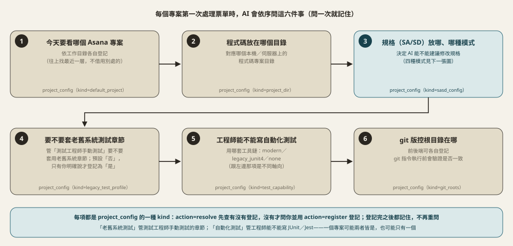
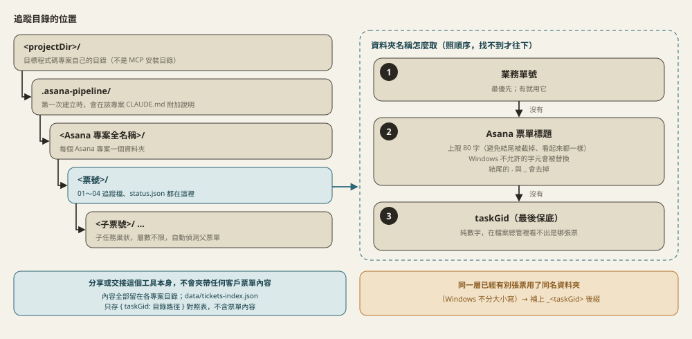
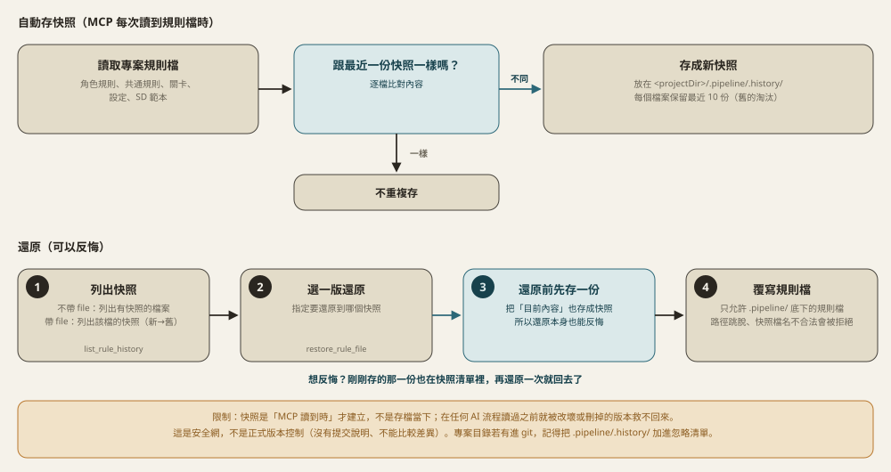
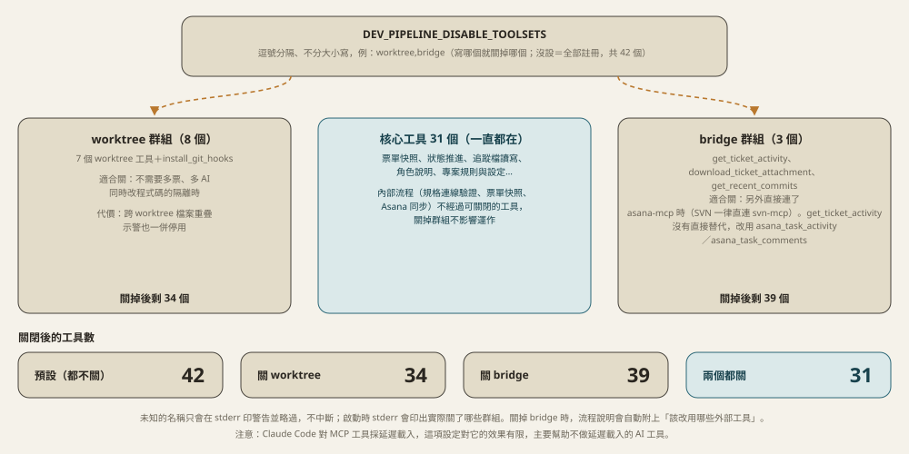

# dev-pipeline-mcp

獨立的 MCP server，讓**任何**支援 MCP 的 AI/host（不限 Claude Code）都能驅動「Asana 票單 → 分析師 → 工程師 → 驗證師」這條自動處理流程。

## 這個 MCP 不會自己思考

跟內建呼叫某家模型 API 的「agent MCP」不同，這個 server **完全不呼叫任何 LLM**、不需要模型 API key。它只做兩件事：提供工具（抓票單、讀寫程式碼、跑 shell、管理追蹤紀錄）跟提供角色說明（`get_pipeline_overview`／`get_role_prompt`）。實際的分析、寫程式碼、驗證判斷，都是**連上這個 MCP 的那個 AI 自己的模型**在做——接 Claude、GPT、Gemini 都能用。

## 安裝與設定

```bash
npm install
npm run build
```

這個 MCP 是「橋接」設計，本身沒有 Asana token、不自己讀寫 SVN，轉呼叫兩個既有 MCP；「Asana 專案↔目錄」「git 版控根目錄」這兩份登記表、`get_recent_commits`（讀 git log）是自己本機維護/實作的：

| 依賴 | 用途 |
|---|---|
| [`asana-mcp`](../asana-mcp) | 抓 Asana 票單/看板/留言（唯讀） |
| [`svn-mcp`](../svn-mcp) | SA/SD 規格文件在 SVN 上的瀏覽/讀取（對 AI 唯讀；工作副本的上傳/更新/刪除只提供給報告網頁上的按鈕） |

啟動時會自動把這兩個當子行程啟動，**必須先各自 `npm install && npm run build` 過**。

**啟動較慢或逾時**（2026-10-28 起的建議）：MCP host 啟動慢、連線逾時時，先調高 host 的啟動逾時（Claude Code 為環境變數 `MCP_TIMEOUT`）；本機 node 型 MCP 也可以用 esbuild 打包成單檔再指向打包檔，縮短冷啟動（2026-10-28 對 `gitlab-mcp`／`db-mcp` 這樣處理過）。

> 這個專案原本還借用一個獨立的 `spec-pipeline-mcp` 提供 `get_recent_commits`，2026-09-09 已經把這個功能收回本專案自己實作（`git-utils.ts`），`spec-pipeline-mcp` 這個獨立 MCP／它專屬的「分析規格檔案」觸發流程已經整個淘汰——那類「先建置案再補規格」的情境，改走本專案既有的 Asana 票單流程即可（規格一律讀 SVN，不用再本機同步一份）。

<details>
<summary>環境變數</summary>

| 變數 | 說明 | 預設值 |
|---|---|---|
| `ASANA_MCP_PATH` | asana-mcp 的 `dist/index.js` 絕對路徑 | `../asana-mcp/dist/index.js`（`npm test` 會先預設指到不存在的檔案，見「自動化測試」） |
| `SVN_MCP_PATH` | svn-mcp 的 `dist/index.js` 絕對路徑 | `../svn-mcp/dist/index.js` |
| `ASANA_PIPELINE_DATA_DIR` | 本機輕量資料（票單索引/登記表/`file-write-state.json`）存放目錄；票單內容本身在各專案的 `.asana-pipeline/` 底下 | `./data` |
| `DEV_PIPELINE_DISABLE_TOOLSETS` | 逗號分隔要關閉的工具群組（`worktree`、`bridge`），見「7. 工具群組可關閉」 | （空，全部註冊） |
| `DEV_PIPELINE_MCP_HTTP_PORT`／`DEV_PIPELINE_MCP_HTTP_HOST` | 報告網頁互動按鈕用的本機 HTTP bridge 監聽位置 | `8097`／`127.0.0.1` |
| `PIPELINE_ASANA_USER_GID` | 直接指定 Asana 使用者 gid，略過向 asana-mcp 查詢（測試或 asana-mcp 連不上時用） | （不設，向 asana-mcp 查） |

**SVN 讀取（`svn_browse`／`svn_cat`／`svn_doc_images`／`svn_log`／`svn_diff`／`svn_find_repo`…）不再由本 MCP 轉發**：驅動 pipeline 的 AI 要直接連 `svn-mcp` 使用這些工具；本 MCP 內部登記規格時驗證 SVN 連線仍會自己呼叫 `svn-mcp`。

`svn-mcp` 被當子行程啟動會繼承父行程環境變數，所以 `SVN_API_BASE`/`SVN_CONNECTION_ID` 只要帶在啟動 `dev-pipeline-mcp` 的 `env` 裡就生效。Asana token 設在 `asana-mcp` 那邊。

</details>

### 建議：在你自己使用的 AI 工具的全域規則檔加一條規則

`.asana-pipeline/` 底下的追蹤檔案有機會被使用者或另一個沒有走這條 pipeline 的 AI 直接用一般 Edit/Write 手動改到——這種情況這個 MCP 完全不知情（見下方「外部修改偵測」），而且**只有在有人明確呼叫 `get_ticket_status`/`read_ticket_artifact` 時才會被抓到，不會主動通知**。

比較可靠的做法是把這條規則放進**你自己使用的 AI 工具的全域規則檔**（不限 Claude Code）——概念上要挑那種「不管在哪個專案目錄開新 session 都會被自動讀到」的設定檔，涵蓋範圍才會比只寫在這個 MCP 的 prompt 裡（只有真的呼叫 `get_pipeline_overview`/`get_role_prompt` 才讀得到）廣。不同 AI 工具這份檔案的名稱、位置都不一樣，要自己對應調整，例如：

| AI 工具 | 對應的全域規則檔 |
|---|---|
| Claude Code | `~/.claude/CLAUDE.md` |
| 其他支援全域系統提示/規則檔的 AI CLI | 該工具說明文件裡「每次啟動都會自動載入」的那份設定檔——沒有的話就只能退回寫在專案層級 |

以 Claude Code 為例，建議加一段類似：

```markdown
## Asana Pipeline 追蹤檔案同步規則

任何專案目錄下只要有 .asana-pipeline/ 資料夾，一律適用：
- 直接用 Edit/Write 改了裡面的 01/02/03/04-*.md（沒透過 write_ticket_artifact）之後，
  接著呼叫 resync_ticket_artifact({ taskGid, filename }) 同步雜湊記錄。
- 不確定追蹤狀態是不是最新的，先呼叫 get_ticket_status 看 external_changes，
  任一個 _externally_modified 是 true 就重新讀全文，不要只信快取摘要。
```

用別的 AI 工具，把上面這段規則內容原封不動搬過去、放進它自己對應的全域規則檔即可——規則本身（呼叫哪個工具、看哪個欄位）是這個 MCP 的行為，跟用哪個 AI 無關，只有「放在哪份檔案」這件事因工具而異。

這終究是提醒 AI 自己記得做，不是工具層級的強制——真正的安全網是「外部修改偵測」那組機制本身（見 [docs/FLOW.md](docs/FLOW.md) 的「外部修改偵測」），這段只是提高被看到、被處理的機率。

### 一次性設定（每個 Asana 專案通常只問一次）



每項都是 `project_config({ kind, action: "resolve" | "register" })` 的一個 `kind`：先 `resolve` 查有沒有登記，沒登記才問你再 `register`（2026-10-27 起取代原本的 `resolve_*`／`register_*` 系列工具，各 `kind` 見下方工具表）。「老舊系統測試」（`legacy_test_profile`，管測試工程師手動測試要不要套老 IE 章節，預設 `false`）跟「自動化測試」（`test_capability`，管工程師能不能寫 JUnit/Jest）是不同軸向，一個專案可能兩者都成立，也可能只成立一個。想一次查完專案、程式碼目錄、SA/SD 設定、git 根目錄四項，可呼叫 `prepare_project`（只讀、不登記，缺項列在 `missing`）。

### SA/SD 規格模式

規格放哪、SD 是誰產的（`external`／`self`／`self-generated`／`unregistered`）、先規格還是先程式碼（`specOrder`），**都是各專案自己的設定**，說明已移到下方「專案專屬規則與關卡」的 **§5 規格模式（SA/SD）**。

---

## 流程圖解

流程圖、狀態機與各角色階段的完整說明在 [docs/FLOW.md](docs/FLOW.md)（原文未刪減）。主題包含：

- 每次執行的迴圈
- 單張票的狀態機
- 工程師階段：寫新程式碼前的查重、共用工具歸屬與命名（2026-10-06 起）
- 工程師階段：要不要補自動化測試（project_config({ kind: "test_capability", action: "resolve" }) / project_config({ kind: "test_capability", action: "register" })）
- 測試工程師階段（tested）
- 01/02/03/04 互相同步
- 外部修改偵測
- 待人工處理清單（PENDING_HUMAN_ACTIONS.html）
- 換 session／換 AI 接手
- 派子代理人的標準做法（forSubagent）
- 多票單／多 AI 併行處理（worktree 隔離）

---

## 追蹤目錄放在哪裡



建在**目標程式碼專案自己的目錄**，不是這個 MCP 的安裝目錄。資料夾命名優先序（2026-09-30 起）：**業務單號 → Asana 票單標題 → taskGid**，細節見圖；標題上限 80 字，是為了避免「前端開發與SQ」這類結尾被截掉、同一條鏈的子任務看起來一樣。

---

## 專案專屬規則與關卡（2026-10-01 起）

流程本身由這個 MCP 統一定義，各專案不再自己維護一套平行的流程文件。專案獨有的要求，放在**該專案自己的目錄**，由 MCP 在對應時機讀取；**沒有這些檔案的專案行為完全不變**。

**檔案放在不分 AI 工具的中性目錄 `<projectDir>/.pipeline/`**，不綁 `.claude/`。舊位置 `<projectDir>/.claude/pipeline-roles/`（`<role>.md`、`gates.json`）仍然讀得到，兩邊都有時**新位置優先**。這些規則都是 MCP 在伺服器端讀取並套用，所以 Claude Code、Codex 或任何能連 MCP 的 AI 都適用，不需要各家工具自己的規則檔（`CLAUDE.md`／`AGENTS.md`）。

### 1. 專案規則 `<projectDir>/.pipeline/roles/all.md`（所有角色共通）與 `<role>.md`（單一角色）
`get_role_prompt({ role, projectDir })` 會把 `all.md`（共通，例如「寫程式前先讀哪些規範檔」）和 `<role>.md`（這個角色專屬）依序附加在通用角色說明後面，衝突時以專案規則為準。`role` 為 `analyst`／`spec-writer`／`engineer`／`verifier`／`tester`。適合放「開發前先讀哪些習慣檔」「SD 範本以專案檔為準」這類指示，不需要改 MCP 程式碼。**`projectDir` 沒帶時，可以改帶 `taskGid`，工具會用這張票記錄的 `project_dir` 反查**，避免漏帶導致補充規則被靜默略過；兩個都沒帶才只回傳通用說明。**派子代理人時，標準做法是 `get_role_prompt({ role, taskGid, projectDir, forSubagent: true })`，把回傳全文（含派工簡報與補充規則段落）原文當子代理人 prompt；子代理人第一步用回傳裡那行 `ToolSearch` 一次載入工具。**

### 2. 專案關卡 `<projectDir>/.pipeline/gates.json`（分析關卡＋實作關卡）


**分析關卡**（`analysisReferences`）：寫入 `01-analysis.md` 時（`write_ticket_artifact`，在既有的 `record_sasd_check` 檢查之後）檢查。設定格式：

```json
{
  "analysisReferences": [
    {
      "ticketNamePattern": "RPT|a_report_",
      "heading": "舊碼參考",
      "pathPrefix": "legacy/src/report/",
      "minPaths": 1,
      "requireSasd": true
    }
  ]
}
```

- `ticketNamePattern` 是正規表示式，只有票名符合的票才會被檢查，同專案其他票不受影響。
- 路徑斜線／反斜線皆可，可附 `:行號`，`pathPrefix` 相對 `projectDir`。

**實作關卡**（`implementationSections`）：寫入 `02-implementation.md` 時檢查，用來把「工程師要先查重再新增方法」這類要求變成機械檢查。

```json
{ "implementationSections": [
  { "ticketNamePattern": "regex", "heading": "查重", "minChars": 40 }
] }
```

- 「該節」指到下一個標題為止；`heading` 是子字串比對，只取第一個符合的標題。
- 只管 `02-implementation.md`，不管 03、04。兩個關卡共通的限制與壞掉 JSON 的處理，寫在上方圖最下面的框。
- **登記時的提示**：`project_config({ kind: "project_dir", action: "register" })` 登記專案目錄時，如果該目錄還沒有 `gates.json`，回傳會多一個 `gatesHint` 欄位，提醒可以複製下方範本；這只是提示，不會擋任何東西，也不會自動複製，要不要啟用由使用者決定。
- **快速啟用查重關卡**：把內建範本 [templates/gates.example.json](templates/gates.example.json) 複製到 `<projectDir>/.pipeline/gates.json` 即生效（`ticketNamePattern` 為 `".*"`＝該專案所有票都要有含「查重」的一節、至少 40 字；想只管特定票就改成票名 regex）。**沒複製就不會有任何機械檢查，既有專案行為不變**；專案已有自己的 `gates.json` 時，把範本的 `implementationSections` 項目合併進去，不要整份覆蓋。

### 3. 專案自己的 SD 範本與版更規範（`<projectDir>/.pipeline/templates/`）

專案可以放 `SD_TEMPLATE.md`（新建規格用）和 `SD_VERSIONING_RULES.md`（修改既有規格用）。`get_sd_spec_template`／`get_sd_spec_versioning_rules` 帶 `projectDir`（或 `taskGid`）時，**有專案版就只回傳專案版、完整取代內建通用版**，沒有才回傳內建版；不帶參數行為跟以前一樣。目的是避免專案檔和內建版兩份高度重疊的內容同時進入 AI 的上下文，也不用再靠角色補充規則叫 AI 另外去讀專案檔。

### 4. 專案設定 `<projectDir>/.pipeline/settings.json`

```json
{ "onlyAssignedToMe": true }
```

- `onlyAssignedToMe: true`：`list_pending_tickets` 只列**指派給目前這個 Asana 帳號本人**的票（帳號身分用 `asana_me` 判斷，其他人的票完全不列，回傳裡會附 `filteredBy` 與 `skippedNotAssignedToMe` 數量）。呼叫時也可以直接帶 `onlyAssignedToMe` 參數覆蓋這個設定；兩者都沒有就列出所有人的票。
- **`flow.profiles[]`（2026-11 起）：各專案自己的規格模式與測試能力。** 每個 Asana 專案（`projectGid`）一筆，同一個 `projectDir` 底下的多個 Asana 專案可以各自不同模式（例如一個專案規格由別人產、另一個由 AI 產）：

  ```json
  {
    "onlyAssignedToMe": true,
    "flow": {
      "profiles": [
        {
          "match": { "projectGid": "<Asana 專案 gid>" },
          "sasd": { "saRoot": "…", "sdMode": "external | self | self-generated | unregistered", "sdRoot": null, "sdOutputPath": null, "svnConnectionId": null, "specOrder": null },
          "testCapability": { "mode": "modern | legacy_junit4 | none", "note": null },
          "legacyTestProfile": false
        }
      ]
    }
  }
  ```

  - `sasd`／`testCapability`／`legacyTestProfile` 的欄位與規則，跟 `project_config` 的 `sasd_config`／`test_capability`／`legacy_test_profile` 完全相同（SA 與 SD 可分開處理：SA 由別人產放在 SVN 唯讀、SD 由 AI 產，就是 `saRoot` 指向 SVN、`sdMode: "self-generated"`）。
  - **讀取優先序：專案目錄的 profile > 這個 MCP 自己的 `data/*.json`**（舊資料不用搬遷，沒有 profile 就照舊）。
  - **登記位置**：`project_config` 的 `register` 在專案目錄可用時會寫進這裡（回傳的 `savedTo: "project"`），否則退回寫 MCP 的 `data/`（`savedTo: "mcp-data"`）。
  - 設定壞掉（不是合法 JSON、欄位不合法、同一個 `projectGid` 重複）會直接報錯，**不會悄悄退回別的模式**；寫入前會先把舊內容存成快照（可用 `restore_rule_file` 還原）。
- 沒有這個檔案就是預設行為（列出所有人的票）。檔案存在但不是合法 JSON 時，`list_pending_tickets` 會直接報錯，**不會悄悄退回「列出所有人」**；判斷不出目前帳號是誰時也一樣報錯。
- 注意：帶了過濾之後，這次寫出的 `PENDING_HUMAN_ACTIONS.html` 只包含你自己的票，其他人的待辦事項要等下一次不過濾的呼叫才會回來；各種票單狀態異動後的局部重寫則不受這個設定影響。

### 5. 規格模式（SA/SD）：每個專案自己的設定

規格模式存在各專案自己的 `<projectDir>/.pipeline/settings.json` 的 `flow.profiles[]`（見 §4）；專案目錄沒有 profile 時才退回 MCP 自己的 `data/*.json`。同一個專案目錄底下有多個 Asana 專案時，每個專案各自一筆、各自不同模式。**SA 與 SD 分開設定**：`saRoot` 永遠指向 SVN 上的 SA，`sdMode` 只管 SD。

| 你的情況 | `sdMode` | 其他欄位 |
|---|---|---|
| SA、SD 都是別人產的，我們只能照著做 | `external` | `saRoot`／`sdRoot`＋`svnConnectionId` |
| SD 是自己團隊產的（放 SVN），要改只能建議、不寫回 | `self` | `saRoot`／`sdRoot`＋`svnConnectionId` |
| SA 別人產，SD 由這個 MCP 產 | `self-generated` | `saRoot`（SVN）、`sdOutputPath`、`specOrder`（必填） |
| 規格和程式都由這個 MCP 產 | `self-generated` | `saRoot` 可填 `N/A-無SA文件`，`sdOutputPath`、`specOrder` 必填 |
| 沒有固定規格，每張票自己問 | `unregistered` | 只需 `saRoot` |

這些設定決定票單要走哪些步驟：`prepare_project` 會依它回傳 `stepPlan`（該專案每張票要走的步驟，`spec_first` 才有「先定規格」步驟、`code_first` 才有「反推規格」步驟），`get_role_prompt` 也只輸出該模式適用的說明。登記方式見 §4 的 `flow.profiles[]`，或用 `project_config({ kind: "sasd_config", action: "register" })`（專案目錄可用時寫進專案目錄，回傳 `savedTo: "project"`）。


- `self-generated` 的規格確認用 `record_spec_confirmation`；`specOrder`（`spec_first`／`code_first`）在 `project_config({ kind: "sasd_config", action: "register" })` 時一併登記，`spec_first` 是原本唯一支援的順序。
- **登記時的檢查**（`project_config({ kind: "sasd_config", action: "register" })`）：只要 SA 有真實的 SVN 路徑（`saRoot` 不是 `N/A` 開頭的占位），任何模式都要帶 `svnConnectionId`（`external`／`self` 一律要）——分析師一定要到 SVN 讀 SA，沒登記連線就讀不到。工具會先 `svn_test_connection`，再用 `svn_browse` 確認 `saRoot`／`sdRoot` 真的存在於該連線的 repo；路徑要用正斜線、相對於 repo 根目錄，**不含本機工作副本的資料夾名**（例如不要寫 `WC資料夾\2-SA\…`），含反斜線、本機絕對路徑、`..` 或路徑不存在都會被拒絕登記。專案真的沒有 SA 文件時，`saRoot` 填 `N/A-無SA文件` 這類 N/A 開頭的占位即可免連線。
- **規格關卡由 `advance_ticket_stage` 強制**（2026-10-28 起，僅 `self-generated`）：`spec_first` 擋推進到 `implemented`、`code_first` 擋推進到 `verified`；沒有「使用者確認過的 SD 草稿」（`record_spec_confirmation({ confirmed: true })`）或「使用者明確表示不需要 SD 的紀錄」就不能過。另外只要票單目前卡在 `sd_drafted` 又還沒確認，不管推進到哪個階段都會被擋。`external`／`self`／`unregistered` 三種模式不受影響，查不到專案設定的票也維持原有行為。
- **「不需 SD」選項**（2026-10-28 起）：`record_spec_confirmation({ taskGid, confirmed: true, sdNotRequired: true, userInstruction })`，僅 `self-generated`，可在 `analyzed` 或 `sd_drafted` 階段呼叫。使用條件：必須是**使用者明確表示**本票不需要 SD，`userInstruction` 必填並記下使用者原話（或原意）；**AI 不可自行提議或決定略過 SD**，不確定就先問使用者。有這筆紀錄時，`get_ticket_status` 與各階段回傳的 `spec_confirmation` 會附 `sdSkipNotice` 稽核字樣（「本票未產出 SD，依使用者指示略過：原話」）。

### 6. 非 Claude 的 AI 怎麼接入
- **關卡與補充規則的套用都在 MCP 裡**，AI 只要連上這個 MCP 並照流程呼叫工具就會生效，繞不過去（關卡）或自動附上（補充規則）。
- **入口**：MCP 連線時會附上一段 `instructions`（處理票單先呼叫 `get_pipeline_overview`、切角色前先呼叫 `get_role_prompt` 並帶 `projectDir`／`taskGid`）。**是否把它顯示給模型由各家 client 決定，不保證每個工具都會用到**，所以這個 MCP 不能只靠它。
- **不走票單流程、只是要在專案裡寫程式碼**時，AI 開始前呼叫 `get_project_rules` 就能拿到共通規則；專案不需要為每個 AI 工具各放一份入口檔（`CLAUDE.md`／`AGENTS.md` 等），規則只維護 `.pipeline/` 這一份。
- 實務上，非 Claude 的 AI 要進入流程，最穩的做法是在該工具自己的專案規則檔（例如 Codex 的 `AGENTS.md`）加一句：「處理 Asana 票單前，先呼叫 dev-pipeline-mcp 的 `get_pipeline_overview` 並照著做」。Claude Code 的「處理今天的問題單」關鍵字觸發，是 `~/.claude/skills/` 底下的 skill，屬於 Claude 專用，其他工具不會有。

### 7. 規則檔快照與還原（`<projectDir>/.pipeline/.history/`）



快照是「MCP 讀到時」才建立，不是存檔當下，是安全網而不是正式版本控制；專案目錄若有進 git，記得把 `.pipeline/.history/` 加進忽略清單。

### 8. 工具群組可關閉（`DEV_PIPELINE_DISABLE_TOOLSETS`）

用環境變數縮小工具清單（tools/list）送進 AI 上下文的量；**預設（沒設）全部註冊**。



```json
"env": { "DEV_PIPELINE_DISABLE_TOOLSETS": "worktree,bridge" }
```

- 逗號分隔、不分大小寫、容許空白。`bridge` 關閉時，`get_pipeline_overview` 與 `get_role_prompt` 的回傳會自動附上替代工具說明；預設不關閉時不會多出任何字。
- **工具數量有變動時，記得同步更新這張圖**（數字以 `tests/toolsets.test.mjs` 為準）。

### 9. 自動化測試

```bash
cd dev-pipeline-mcp
npm test        # 等同 npm run build && node --import ./tests/helpers/safe-env.mjs --test
node --import ./tests/helpers/safe-env.mjs --test tests/gates.test.mjs   # 單檔（要先 npm run build，也要帶 --import）
```

- 使用 Node 內建的 `node:test`，沒有額外依賴；測試放在 `tests/*.test.mjs`（目前約 32 個檔、約 290 個測試案例），從 `dist/` 以相對路徑匯入。
- 一律使用暫時資料目錄（設 `ASANA_PIPELINE_DATA_DIR`），**不連 Asana、不碰正式 `data/`**。涵蓋規則檔與快照、專案關卡、工具分組、列表過濾與快取、`nextAction`、角色說明組裝、總覽字數、預設專案、SD 文件、輸出截斷、狀態推進精簡回傳、專案 gid 等。
- **安全預載**（2026-10-28 起）：`tests/helpers/safe-env.mjs` 會把 `ASANA_MCP_PATH` 預設指到不存在的檔案，避免任何測試忘了設定時啟動真的 asana-mcp（會用到使用者真實憑證）；單檔執行不帶 `--import` 就沒有這層保護。需要假的 asana-mcp 的測試，自己覆寫 `process.env.ASANA_MCP_PATH`（例如 `tests/helpers/fake-asana-mcp.mjs`）。**單元測試不得啟動真的 asana-mcp。**
- 寫會觸發狀態寫入或報告同步的測試，必須比照 `tests/pending-actions-sync.test.mjs` 處理（指向不存在的 `ASANA_MCP_PATH`、設 `PIPELINE_ASANA_USER_GID`），並在 `after` 關閉子 MCP 連線，否則測試行程不會結束。
- 另有「契約測試」固定工具名稱清單與關鍵參數、`core` 總覽字數上限，以及「客戶代號守門」掃描 `src/`、`templates/`、`README.md`、`docs/MANUAL.html`、`tests/`，避免之後不小心刪掉參數或帶入真實客戶代號。刻意新增或移除工具時，要同步更新 `tests/toolsets.test.mjs` 的工具清單與數量。
- **未涵蓋**：`list_pending_tickets` handler 本體（會連 Asana，只測它用到的過濾與快取邏輯）、HTTP bridge、worktree 實際 git 操作。

---

## 提供的工具

<details>
<summary>展開完整工具清單（42 個）</summary>

| 工具 | 用途（一行版） |
|---|---|
| `get_pipeline_overview` | 取得整條流程說明（第一步一定先呼叫） |
| `get_role_prompt` | 取得單一角色（分析師／規格撰寫者／工程師／驗證師／測試工程師）的職責說明 |
| `get_project_rules` | 取得專案自己定義的開發規則（`.pipeline/` 共通規則、角色專屬規則、分析關卡） |
| `list_rule_history` | 列出專案規則檔（`.pipeline/` 底下）的歷史快照 |
| `restore_rule_file` | 把規則檔還原成某個快照 |
| `prepare_project` | 開工準備（取代逐個 `project_config` resolve）：一次回傳預設 Asana 專案、`projectDir`、SA/SD 設定、git 根目錄 |
| `project_config` | 專案層級設定的單一入口：`project_config({ kind, action: "resolve" \| "register", ... })` |
| `list_pending_tickets` | 列出某個 Asana 專案尚未處理完成的票單 |
| `get_ticket_snapshot` | 抓票單內容＋留言，寫入追蹤檔案 |
| `relocate_ticket_project` | 第一次 `get_ticket_snapshot` 傳錯 `projectName` 時，把票（含子任務）的追蹤資料夾搬到正確位置 |
| `get_ticket_activity` | 取得票單完整活動時間軸（留言＋系統事件＋附件，依時間排序） |
| `download_ticket_attachment` | 下載某個附件到本機暫存檔（`attachmentGid` 來自 `get_ticket_activity`） |
| `read_project_sd_doc` / `write_project_sd_doc` | 讀寫「自維護」SD 文件（`self-generated` 專用），寫在 `sdOutputPath` 真實本機檔案 |
| `get_sd_spec_template` / `get_sd_spec_versioning_rules` | SD 規格撰寫範本／版更規範，寫入前應先呼叫其中之一 |
| `get_test_engineer_guide` | 取得測試工程師說明書（通用／報表／老舊系統三章檢查清單，另有「測試證據」章節） |
| `get_recent_commits` | 查某目錄最近的 git commit |
| `read_project_file` / `write_project_file` / `list_project_dir` / `search_project_text` | 讀寫/搜尋專案檔案（限 `projectDir` 範圍內） |
| `run_project_shell` | 跑 shell 指令 |
| `get_ticket_status` / `advance_ticket_stage` | 讀取/更新票單追蹤狀態，附 `sync_flags`／`needs_human_review`／`external_changes` |
| `write_ticket_artifact` / `read_ticket_artifact` | 讀寫追蹤目錄下的分析/實作/驗證/測試檔案 |
| `record_test_evidence` | 測試工程師記錄一筆測試證據，並把證據檔備份到票單目錄 |
| `resync_ticket_artifact` | 手動改過追蹤檔案後，把磁碟上的實際內容重新雜湊寫回 `sync.*_hash` |
| `resolve_manual_action` | 移除某張票 `manualActions` 裡使用者已處理完的一項 |
| `record_sasd_check` | 記錄這張票有沒有對應 SA/SD |
| `record_confirmation` | 記錄結案前唯一一關人類確認（`confirmed`／`note`），`tested` 階段之後才能呼叫 |
| `record_spec_confirmation` | 記錄規格草稿定案的確認結果（僅 `self-generated`），`sd_drafted` 階段之後才能呼叫 |
| `request_reanalysis` | 標記某張票「使用者要求優先重新確認」 |
| `create_ticket_worktree` | 為一組票單建立獨立 git worktree（已存在則冪等回傳既有資訊） |
| `join_ticket_worktree` | 把另一張票單併入既有的 worktree 分組 |
| `get_worktree_status` | 查詢 worktree 真實改動的檔案 |
| `merge_ticket_worktree` | 需要才 rebase、合併回來源分支（只更新本機分支，不 push；衝突時停在中間狀態） |
| `abandon_ticket_round` | 中斷一輪還沒合併的 worktree 工作（先安全 commit，不刪 worktree／分支） |
| `finalize_ticket_worktree` | 併入的票單全部確認結案後，清除 worktree 資料夾與分支 |
| `list_worktrees` | 列出所有登記中的 worktree，並跟 git 自己的 `worktree list` 交叉比對出對不起來的項目 |
| `install_git_hooks` | 為已登記的 git 根目錄安裝 `post-commit`／`post-merge` 原生 hook |

</details>

每個工具的完整參數與行為說明（含 `project_config` 各 `kind`）見 [docs/TOOLS.md](docs/TOOLS.md)，也都寫在各工具自己的 description 裡。

## 安全限制

- `run_project_shell` 拒絕 `git push`、`--force`/`-f`、`reset --hard`、`clean`、`checkout --`/`checkout .`、`restore`、`branch -D`；其餘 git 指令正常可用。
- 任何 git 指令執行前會驗證：`projectDir` 必須先 `project_config({ kind: "git_roots", action: "register" })` 登記過，且指令實際解析到的 repo root 要跟登記的一致，避免在沒有獨立 `.git` 的子目錄誤跑 `add`/`commit`。
- `read_project_file`/`write_project_file`/`list_project_dir`/`search_project_text`/`run_project_shell` 都限制在提供的 `projectDir` 範圍內，跳出範圍的路徑一律拒絕。
- `write_project_file` 會記住自己上次寫入每個檔案的內容雜湊：偵測到外部修改（其他工具/使用者/別的 AI 改過）預設擋下寫入，要帶 `acknowledgeExternalChange: true` 才會覆蓋。
- **不可自行略過 SD**（2026-10-28 起）：`self-generated` 專案的規格關卡由 `advance_ticket_stage` 強制；只有使用者明確表示本票不需要 SD 時，才可帶使用者原話呼叫 `record_spec_confirmation({ sdNotRequired: true, userInstruction })`，AI 與子代理人不可自行提議或決定。
- **commit／push 由主流程依使用者指示決定**：子代理人（工程師、驗證師、測試工程師）不自行 commit／push；`run_project_shell` 本身也拒絕 `git push`。
- **單元測試不得啟動真的 asana-mcp**：`npm test` 以 `tests/helpers/safe-env.mjs` 把 `ASANA_MCP_PATH` 預設指到不存在的檔案，見「自動化測試」。
