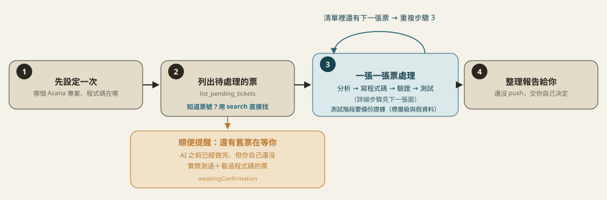
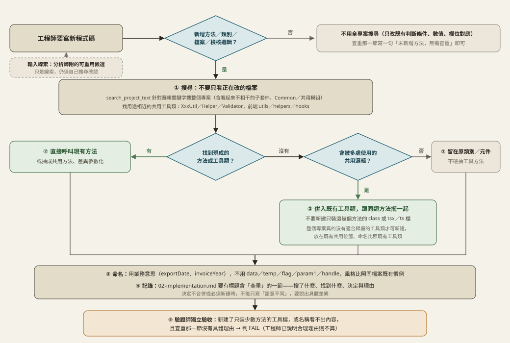
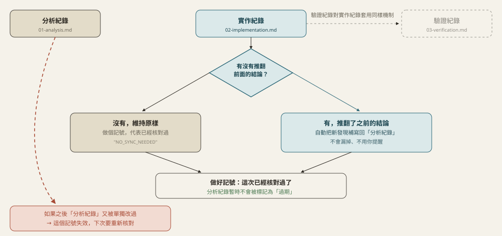
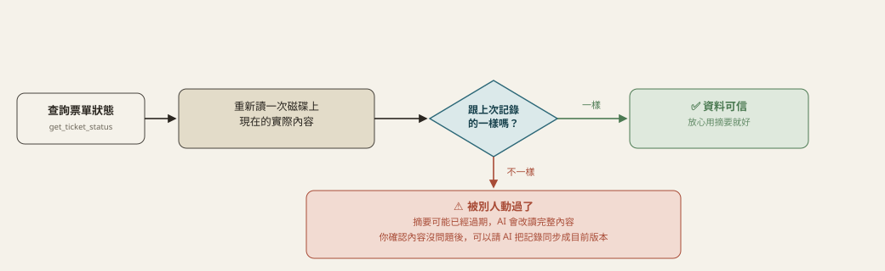
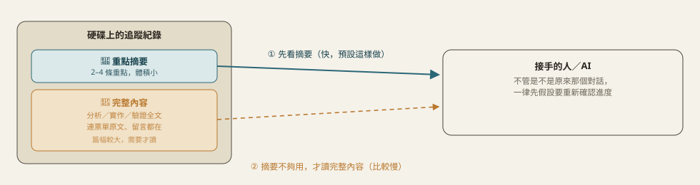
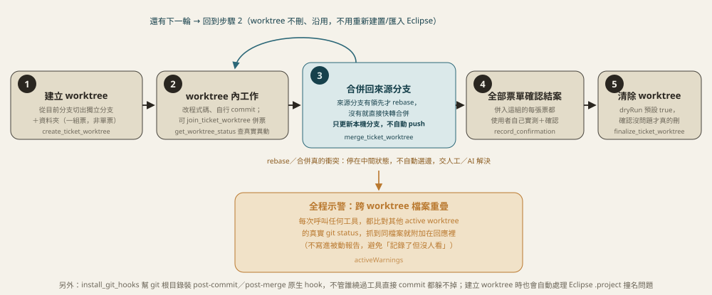

# 流程圖解

> 這份內容原本在 [README](../README.md) 的「流程圖解」章節，為了讓 README 保持精簡而搬到這裡，內容未刪減。

> 想看白話版、非技術人員也看得懂的完整手冊：clone 這個 repo 後用瀏覽器打開 [`docs/MANUAL.html`](docs/MANUAL.html)（GitHub 網頁只顯示 `.html` 原始碼，不會渲染）。下面是給工程師/AI 看的技術版，每個小節預設收合，點開才看得到細節。

<details>
<summary>每次執行的迴圈</summary>



`list_pending_tickets` 每次呼叫都會多回傳一份清單：`awaitingConfirmation`（AI 驗證師判過 `PASS`、Asana 內容也沒再變過，但**使用者自己還沒實際測過＋審視程式碼品質**的票）。這份清單每次都要主動列給使用者看（不因為這次是來處理別的新票就略過），直到每一張都呼叫 `record_confirmation` 表態，才會從清單消失。

</details>

<details>
<summary>單張票的狀態機</summary>

![票單狀態機：new 到 snapshot 到 project_dir_confirmed 到 analyzed 到 implemented 到 verified 到 tested 依序推進，只會往前走；自維護規格的專案會多一關 sd_drafted 規格確認（沒確認過、也沒有使用者說本票不需要 SD 的紀錄，工具直接擋下），依 specOrder 設定出現在 analyzed 之後（spec_first，卡在推進到 implemented 之前）或 implemented 之後（code_first，卡在推進到 verified 之前）；verified 或 tested 且 FAIL 時依 rootCause 自動路由回分析師或工程師重跑，兩階共用同一組 consecutive_fail_count，達到門檻才停下來問使用者；tested 階段裡 AI 沒把握精確判定的測試項目不算 FAIL，只會列進待確認清單；tested 且 PASS 之後若偵測到內容雜湊改變，會觸發警示標記 needs_reanalysis，verdict、confirmation 一併清空，逼下一輪重新從分析師開始；內容沒再變的話則落入待使用者確認狀態，confirmed:false 會導向跟 FAIL 一樣的根因分流，直到 record_confirmation 帶 confirmed:true 才進入已結案](img/ticket-state-machine.svg)

七格 `stage`（灰／綠）只會往前走，不會跳過也不會倒退；`snapshot` 下的灰圈是省 token 捷徑（內容雜湊沒變就不重寫、不回全文）。最後一格 `tested`（測試工程師，見下方「測試工程師階段」一節）是 `verified` 判 PASS 之後、人類最終確認之前新增的一關，每張票都會經過，套用哪些檢查項目由 AI 依這張票的改動內容自己判斷。紅卡有兩張：右上角是內容變動的例外——`tested` 且 `PASS` 之後若偵測到 Asana 內容真的變了，會亮起 `needs_reanalysis` 旗標逼下一輪重新分析、`verdict`、`confirmation` 一併清空，但 **`stage` 本身不會倒退**，仍顯示 `tested`；下方較寬那張是 **`verdict: FAIL` 的根因分流**——`verified` 或 `tested` 任一階段 `advance_ticket_stage` 設 `FAIL` 時必填 `rootCause`（`"analysis"`/`"implementation"`），AI 依此自動跳回分析師或工程師重跑，不用停下來問使用者，兩階共用同一組 `consecutive_fail_count`，由工具機械式維護（FAIL 累加、PASS 歸零），達到門檻（`needs_human_review`，預設連續 3 次）才停下來問。`tested` 階段裡 AI 沒把握精確判定的測試項目（`needs_manual_check`）不算 FAIL，不影響這裡的路由，只會列進 `manualActions` 帶到黃卡那一關給使用者。

**自維護規格的專案（`sdMode: "self-generated"`）會多一關 `sd_drafted` 規格確認**，出現的時機依這個專案登記的 `specOrder` 而定：`spec_first`（原本唯一支援的順序）卡在 `analyzed` 之後、`implemented` 之前——規格先定案，工程師才動手寫程式碼；`code_first` 卡在 `implemented` 之後、`verified` 之前——工程師先直接寫程式碼，規格撰寫者再依實際改動反推補一份草稿。兩種順序共用同一個 `spec_confirmation` 欄位跟同一套擋下邏輯，`advance_ticket_stage` 只看「目前是不是卡在 `sd_drafted` 又還沒確認」就會擋下，不需要額外查 `specOrder`。

黃卡是另一個獨立軸向：`tested` 且 `PASS`、內容也沒再變的情況下，票單會先落入「待使用者確認」——**`verdict` 是 AI（驗證師或測試工程師）自己判的結論，不等於真正結案**。使用者呼叫 `record_confirmation({ taskGid, confirmed: true })` 之後，才會真正進入綠卡「已結案」。**`confirmed: false`（回報有問題）會把 `verdict` 重設回 `null`、標記 `humanRejected: true`，重新套用跟上面 `FAIL` 完全一樣的根因分流機制**，不是留給人工事後自己判斷、也不是另開一條獨立流程。這整段狀態轉換只落在本地追蹤檔案裡，**不會回寫到 Asana 本身**——`asana-mcp` 刻意設計成唯讀，Asana 上要不要標記完成一律交由使用者自己手動處理。

</details>

<details>
<summary>工程師階段：寫新程式碼前的查重、共用工具歸屬與命名（2026-10-06 起）</summary>



**為什麼要規定這一步**：子代理人遇到需求常直接新增一個私有方法或一個新的工具檔，沒發現專案裡早就有別人寫好的共用檢核或工具，結果同一段邏輯散在好幾處，之後改一次要改好幾個地方；命名也常用 `data`、`temp`、`flag` 這類看不出內容的名字。

- **門檻**：只有新增方法、類別/元件/檔案、檢核/轉換/格式化邏輯才必須做全專案搜尋；只是改既有方法裡的條件、數值、欄位對應，查重那一節寫一句「未新增方法，無需查重」即可，避免小票也被迫交一份形式上的搜尋紀錄。
- **共用方法放哪**：新的可共用方法要併進專案已經存在的工具類（後端 `XxxUtil`/`XxxHelper`/`XxxValidator`，前端 `utils/`、`helpers/`、`hooks/` 底下的既有檔案），跟同類方法擺在一起；只有整個專案真的沒有適合歸屬的工具類、而且這批方法會被多處使用，才可以新建，並放在既有共用位置、命名比照既有工具類。只有這張票自己用得到的邏輯留在原本的類別/元件，不硬抽。
- **記錄**：`02-implementation.md` 的查重那一節（標題含「查重」）要寫搜了什麼、找到什麼、決定與理由。想把「一定要有這一節」變成機械檢查，用下方「實作關卡」（`implementationSections`），這條規則本身只約束說明文字，不會自己擋寫入。
- **驗收**：驗證師會獨立檢查這輪新增的檔案——新建了只裝少數方法的 class 或 tsx/ts、而專案其實有適合歸屬的既有工具類，或新增名稱是 `data`/`temp`/`flag` 這類看不出內容的，且查重那一節沒有具體理由，就判 `FAIL`（`rootCause: "implementation"`）。
- **分析師線索**：分析師判斷修改方向會新增方法或檢核邏輯時，會在 `01-analysis.md` 與摘要附上疑似可重用的既有類別/方法（路徑、方法名、適用原因）當候選線索；工程師仍須自己查重確認，驗證師也以此當比對基準。
- **範圍**：這幾條只在走這個 MCP 的工程師角色（`get_role_prompt` 的 `engineer`）生效，不管專案有沒有登記自動化測試都會帶；沒有走票單流程、單純寫程式的情境，要靠專案自己的規則檔（`get_project_rules`）。

跟這張圖同一批調整的工程師說明還有三點：**SA/SD 的位置**看 `get_ticket_status` 的 `sasd_info`（`self-generated` 專案改用 `read_project_sd_doc`），前端只依 SA、後端只依 SD；**commit 由主流程依使用者指示決定**（工程師與子代理人不自行 commit），沒 commit 就依固定格式列出「尚未 commit」的檔案；**停下來問使用者**只留給規格/分析/程式碼衝突、要動建置依賴、第一次登記測試能力這類真正需要人決定的事，擺放位置、命名、併入哪個工具類這類實作細節由工程師依專案慣例自行判斷並寫進 `02-implementation.md`。

</details>

<details>
<summary>工程師階段：要不要補自動化測試（<code>project_config({ kind: "test_capability", action: "resolve" })</code> / <code>project_config({ kind: "test_capability", action: "register" })</code>）</summary>


跟 `sdMode`/`specOrder` 一樣是**專案層級設定**，第一次進到這個專案的工程師階段（`found: false`）才會問使用者一次，問完登記之後同一個專案不用每張票再問。三種模式裡，`legacy_junit4` 如果建置設定還沒加測試依賴，AI 會先問使用者要不要由它加上去，不會擅自改 `pom.xml`/`build.gradle`；`none` 是刻意的選擇（例如上銀，JDK6/7且暫不引入測試依賴），不代表哪個環節沒做好。

</details>

<details>
<summary>測試工程師階段（<code>tested</code>）</summary>

`verified` 判 PASS 之後、人類最終確認之前新增的一關，每張票都會經過。跟驗證師（核對規格/程式碼是否一致）不同——測試工程師核對的是「這段程式碼在各種情境下實際跑起來對不對」，依 `get_test_engineer_guide` 取得的測試工程師說明書（通用測試框架／報表測試／老舊系統測試三章）跑情境測試。**如果 `project_config({ kind: "test_capability", action: "resolve" })` 回傳的 `mode` 不是 `none` 且工程師這輪真的補了測試，測試工程師會優先重新跑一次那些測試當作情境測試的交叉核對證據**——測試涵蓋到的分支直接算 `verified_pass`/`verified_fail`，沒涵蓋到的（需要真的瀏覽器操作、真的資料庫特定狀態才能觸發）才需要另外判斷是不是只能列 `needs_manual_check`。

**每個測試項目自己標記結果類型，不是整張票綁一個結論**：AI 真的有辦法精確判定的項目（例如跑得動的邊界值測試、報表欄位/公式逐欄比對、用指定版本實際編譯）標記 `verified_pass`/`verified_fail`，只有 `verified_fail` 才影響整張票的 `verdict`、觸發跟驗證師一樣的根因自動打回；AI 沒有精確依據、只能提醒使用者的項目（例如報表版面視覺比對、老 IE 實際渲染）標記 `needs_manual_check`，不卡關，透過 `manualActions` 帶到人類最終確認那一關。

**報表／老舊系統兩章是不是套用，AI 依這張票改動的檔案自己判斷**，不用整份說明書每次全套用。老舊系統章節額外多一層：只有 `project_config({ kind: "legacy_test_profile", action: "resolve" })` 回傳 `true` 才套用——這是專案層級的布林設定（`project_config({ kind: "legacy_test_profile", action: "register" })`），預設 `false`，只有使用者明確告知「這個專案是 JDK6+舊IE 這類環境」才登記為 `true`，AI 不會自己依程式碼特徵猜測。


**測試證據（每張票都要）**：測試工程師用 `record_test_evidence` 把證據複製備份進票單追蹤目錄的 `test-evidence/<功能名稱>/`，讓使用者回頭觀察；寫 04-test.md 與推進到 `tested` 都會檢查「至少 1 筆證據」。
- **類型**（`fileKind`）：`api-call`（真實呼叫的原文：method、URL、request、HTTP 狀態、response、耗時，禁止手寫改寫）、`test-report`（備份 build/test-results 實際報告）、`db-state`（用 db-mcp 唯讀查詢存下的測試前後狀態）、`excel`、`pdf`。
- **測試層級**（`testLevel`，每筆必填）：`unit-mock`（依賴全 mock）< `integration-db`（連真實資料庫）< `live-api`（打真實運行中的服務）；04-test.md 宣告的層級必須等於證據中最高者，只有 `unit-mock` 不得宣稱已驗證真實 DB／API。
- **機密遮蔽**：api-call／db-state／test-report 的文字檔會掃描未遮蔽的 Authorization/Bearer token、JWT、password/secret/api key/token 值、連線字串帳密，命中就拒絕並回報檔名與行號（不回印內容）；共用 `src/sensitive-patterns.ts`，與 `manualActions` 檢查同一份基礎 pattern。
- **截圖必須來自實際檔案**，禁止轉網頁重畫或依公式重算。PDF 用 PyMuPDF（`pymupdf`）逐頁轉 PNG（全自動）；Excel 這台機器無法真實渲染，工具只備份實際 xlsx 並標記 `pendingManualScreenshot`，寫 04-test.md 時自動加一條待辦，使用者用 Excel 截圖放進同一資料夾後，再用同功能名稱與原檔名重複呼叫 `record_test_evidence` 補登即清除旗標。
- **每筆證據只存一個檔案，假資料一眼看得出來**：真實資料存 `test-evidence/<功能名稱>/<原檔名>.<副檔名>`；假資料存 `test-evidence/【假資料】<功能名稱>/<原檔名>_假資料.<副檔名>`（截圖 `<原檔名>_假資料_截圖_N`）。**不另存原始檔**：假資料的 excel/pdf 只存 `markedFile`，`sourceFile` 只在 `status.json` 記絕對路徑與 sha256（`files.original`）供追溯。同一筆（功能名稱＋原檔名）再次呼叫（含改 `usesFakeData`）會搬到新位置並刪除舊檔；舊格式備份（`_原始`、`_假資料標註`、舊資料夾名）也在再次呼叫時換成新命名、舊檔刪除、空資料夾移除。舊檔刪不掉（例如被 Excel 開著，旁邊有 `~$` 鎖定檔）**不會讓登記失敗**：呼叫回 `success:true` 與 `cleanupWarnings`，關閉檔案後再呼叫一次即重試清理；`get_ticket_status` 的 `test_evidence.stale_old_backups` 會提示未清理的舊備份。
- **假資料標註**：固定文字 `【測試假資料，非正式資料】`。Excel 副本標註為紅字、粗體、字級 14 以上，放在截圖第一眼看得到的空白位置（前 5 列內的空白列或資料格右邊，不放遠欄），不更動任何既有儲存格與合併範圍；PDF 每頁斜向浮水印；呼叫時帶 `markedFile` ＋ `fakeDataMarked: true`（標註是否真的在檔案內，工具無法自動驗證）。api-call／db-state 的 sourceFile 第一個非空白行必須就是這段文字（工具讀檔驗證）；test-report 不改檔，只靠檔名、資料夾與記錄標示。
- 04-test.md「測試證據」表格欄位：功能名稱｜資料來源（假資料／真實資料）｜測試層級｜檔案類型｜證據檔位置（單一檔案）｜截圖｜備註；有假資料證據時內文必須出現「假資料」。
- 做法與程式碼範例見 `get_test_engineer_guide` 第五章。
</details>

<details>
<summary>01/02/03/04 互相同步</summary>



跟上一張圖是不同軸向的雜湊比對：那張管「票單原文 vs 追蹤系統」，這張管「01/02/03/04 四份文件彼此」。`write_ticket_artifact` 寫 02/03/04 時 `syncNote` 是必填欄位（可以填 `NO_SYNC_NEEDED`，但不能不填），逼呼叫端每次都對「要不要同步」做一次明確判斷——這是這條 pipeline 曾經反覆修正十幾輪、分析文件完全沒跟上、全靠使用者事後肉眼發現的問題換來的強制檢查。

</details>

<details>
<summary>外部修改偵測</summary>



跟上一張「01/02/03/04 互相同步」圖是不同軸向的比對：那張比的是「兩份都是這個 MCP 自己以前記錄的雜湊」彼此對不對得起來（`sync_flags`）；這張比的是「這個 MCP 記錄的舊雜湊」跟「磁碟上現在真正的內容」對不對得起來（`external_changes`）——**只有這組比對才抓得到「使用者或別的沒走這條 pipeline 的 AI，直接手動編輯了追蹤檔案」這種情況**，因為 `sync_flags` 用的兩個雜湊都只在呼叫 `write_ticket_artifact` 時才會更新，繞過它就不會被更新到，拿兩個「一樣沒被更新過」的舊值互相比，永遠看起來「一致」。

`get_ticket_status` 每次呼叫都會當場重新讀一次 01/02/03/04 現在的內容、重新算雜湊，回傳裡的 `external_changes.{analysis,implementation,verification,test}_externally_modified` 任一個是 `true`，就代表對應那份文件被外部改過——這個工具不會自動修正，只負責誠實回報；確認過修改沒問題、想把雜湊記錄同步回目前內容，另外呼叫 `resync_ticket_artifact`。這個機制不需要任何人記得做什麼，純粹是被動的、每次查詢都會自己重算的偵測，不像「叫 AI 記得同步」那樣不可靠。

</details>

<details>
<summary>待人工處理清單（<code>PENDING_HUMAN_ACTIONS.html</code>）</summary>

![待人工處理清單持久化機制：呼叫 list_pending_tickets 並帶上 projectName 時，會掃描這個 Asana 專案所有票單、彙整待確認規格草稿（僅 self-generated 專案）／待確認／卡住需要介入／Asana 內容已變更待重新確認／需要你手動處理的事項（要貼上執行的 SQL 等內容會收在該項底下，可展開並一鍵複製）／Git 尚未 commit 的變更／SVN 尚未上傳的變更（可在網頁上勾選上傳、更新、刪除）七類項目，整份覆寫進一份互動網頁 PENDING_HUMAN_ACTIONS.html；這份檔案落在磁碟上，任何 session、甚至不開 AI 都能直接打開看，勾選/確認按鈕會即時呼叫本機 HTTP bridge 寫回票單狀態，不會因為聊天記錄被清掉或壓縮就遺失；另一個觸發路徑是 install_git_hooks 裝的 git 原生 hook，人工手動 commit/merge 時也會局部重整這份報告，不用等 AI 呼叫任何 pipeline 工具，第一次觸發有一次性冷啟動延遲，之後很快；同一區塊有 2 項以上時可批次勾選（標記已處理／請 AI 優先處理／確認通過，打回需逐項處理）；規格書放在 SVN 上的專案，頁面最上方還有一個「編輯 SVN 上的規格書」連結（連到 svn-edit，不計入七類，因為它不是待辦事項）](img/pending-actions-report.svg)

過去「這張票需要你確認」「這個 SQL 只能你手動執行」這類提醒，只會在當次聊天回覆裡講一次——換個 session、關掉對話視窗，這份清單就沒了，只能重新問 AI 才會再看到一次。

現在 `list_pending_tickets({ projectGid, projectName, sectionFilter? })` **只要帶 `projectName`**，每次呼叫都會把當下算出來的七類「需要人工處理」項目整份覆寫進 `<projectDir>/.asana-pipeline/<projectName>/PENDING_HUMAN_ACTIONS.html`——**不是純文字，是一份可以互動的網頁**，其中四類直接在頁面上點就能生效，不用回頭問 AI：

1. **待確認規格草稿**（可互動 ✅／❌）——只有 `sdMode: "self-generated"` 的專案會出現：規格撰寫者已產出草稿，等你確認可以開始寫程式碼，或打回並簡短說明哪裡要改。按鈕即時呼叫 `record_spec_confirmation`。
2. **待確認**（可互動 ✅／❌）——AI 驗證師／測試工程師都判過了，等你自己實測＋審視程式碼品質；按「沒問題，結案」或「有問題，回報」（要填一句原因）即時呼叫 `record_confirmation`。
3. **卡住需要你介入**（唯讀）——連續 `FAIL` 已經達到門檻（`needs_human_review`），AI 不會再自動重跑。這個狀態沒有對應的「標記已處理」按鈕，**但不要只跟 AI 說「繼續處理」**——那很可能只是用同一套已經失敗 3 次的邏輯再試一次，變成失敗→問你→你說繼續→再失敗的空轉。先看清楚 AI 列出的這幾輪 FAIL 理由，給出新的判斷或方向，AI 才會（也才應該）繼續往下走；之後 PASS 會自動清除這一項。
4. **Asana 內容已被異動，待重新確認**（可互動 ☑️，2026-09-17 起）——先前已經處理過（甚至已經 PASS）的票單，Asana 上的內容後來又被改過（用 `modified_at`／`needs_reanalysis` 判斷），不能因為之前處理過就跳過。**這一塊只列「Asana 上指派人是 asana-mcp 帳號本人」的票單**（票單狀態常在不同人之間流轉，內容變了但不是指派給你的就不冒出來；沒有例外，連勾過「請 AI 優先處理」的票轉手給別人後也不再顯示，旗標仍在，AI 照樣會從 `tickets[].humanRequestedReanalysis` 看到）。勾選「請 AI 優先處理」會呼叫 `request_reanalysis({ taskGid })`，寫入 `human_requested_reanalysis` 旗標——**這個勾選只是標記請求，bridge 沒有 LLM 能力，不會、也不能立即觸發任何分析**，要等下一個呼叫 `list_pending_tickets` 的 AI（任何 session、任何廠牌，見 `tickets[].humanRequestedReanalysis`）主動對這張票呼叫 `get_ticket_snapshot`，旗標才會被清掉。已經勾過的項目會顯示成唯讀提示，避免重複勾選。這一項會在 AI 真的重新分析這張票之後自動消失。
5. **需要你手動處理的事項**（可互動 ☑️）——來自 `write_ticket_artifact` 寫 02/03/04 時**必填**的 `manualActions` 參數（可以是空陣列，代表明確確認這次沒有）。典型例子是「已產出 SQL，只能由你到 Database 工具手動執行」——這類一次性提醒過去只寫在全文或聊天視窗裡，換個 session、或沒仔細重讀全文就會被漏掉，現在強制工程師/驗證師/測試工程師每次都要明確宣告一次。**勾選框即時呼叫 `resolve_manual_action({ taskGid, filename, action })`，精準移除那一項**，不用整份重新宣告，也不用回頭問 AI。`manualActions` 只能寫技術性描述，寫入前會自動掃描是否夾帶完整 SQL 語句全文或憑證/連線字串，抓到會直接拒絕寫入（見 `detectSensitiveManualActions`）。**要你複製貼上去執行的內容（SQL、設定值、指令…）**則寫在 02/03/04 文件本文裡，用帶 `manual` 標記的程式碼區塊（開頭三個反引號後接語言與 `manual:簡短標題`，例如 sql manual:新增3語系選項）；報告產生時會從文件現讀這些區塊，以可展開、附「複製」按鈕的方式顯示在該票的待辦下面，不用再開文件找。內容不會存進 `status.json`（所以不繞過上面的防護），待辦被勾掉後區塊也跟著消失；沒帶 `manual` 標記的一般程式碼區塊不會顯示。
6. **Git 尚未 commit 的變更**（唯讀）——對每個已登記的 git 版控根目錄實際跑一次 `git status --porcelain`，再用每張票 `manualActions` 裡點名「尚未 commit」的檔名去篩選、依票單分組，只列出「git 真的還沒 commit、又有票單認領」的檔案；跟這次 pipeline 無關的其他未 commit 檔案整份省略。還沒呼叫過 `project_config({ kind: "git_roots", action: "register" })` 的專案，這一項會顯示「還沒登記」。commit 之後這一項會自動消失，沒有對應的按鈕——那本來就是你自己跑 `git commit` 的事。
7. **SVN 尚未上傳的變更**（可互動 ☑️，2026-10-02 起）——對每個專案登記的 SVN 工作副本（`project_config({ kind: "svn_workcopies", action: "register" })`，登記前會真的跑 `svn status` 驗證）列出 `svn status` 結果：已修改／新檔案／已加入／已標記刪除／本機遺失／衝突，`~$` 開頭的 Office 暫存鎖定檔自動濾掉。每列可「看差異」（可展開）、「標記為從 SVN 刪除」、「取消加入／取消刪除／還原檔案」；勾選項目並在網頁上填寫 **commit 訊息**後按「上傳選取的項目到 SVN」，會先把新檔案加入版控再一次 commit；另有「從 SVN 更新」（遇到衝突只標記、不自動解決）與「重新整理狀態」。**這些寫入操作只有網頁按鈕能觸發，AI 沒有任何能修改 SVN 的 MCP 工具**——svn-mcp 的寫入函式（`workcopy-client`）沒有註冊成工具，並有契約測試鎖住 MCP 工具清單維持唯讀；bridge 的 `/svn/*` 端點必須帶 `X-Bridge-Token`（隨機密鑰存在資料目錄的 `bridge-token.txt`，只寫進產生的 HTML，別的網站拿不到），操作對象只能是已登記的工作副本（用 label 指定，路徑與連線取自登記資料），上傳前會跳出確認視窗，每次寫入操作都在資料目錄的 `svn-operations.log` 留一行稽核紀錄。限制：衝突項目不能上傳；「還原」只允許用在新增／刪除／遺失，不會丟掉已修改的內容（對資料夾還原時，底下只要有已修改的檔案就拒絕；以 `svn copy` 加入且沒修改過的資料夾，還原會移除那份複本）；衝突項目不提供取消／刪除按鈕，改在該列說明去 TortoiseSVN 處理；操作失敗的訊息會顯示在該列，請求超過 90 秒沒回應會中止並說明；二進位檔（xlsx／docx／jasper 等）無法顯示文字差異；有未上傳修改的檔案不能直接標記刪除。換新報告（token 不變）不需要重新登記；token 檔被刪掉重新產生後，舊的報告要重新整理才會再生效。**（2026-10-30 起，已有 svn-edit 連結的專案不再列這份本機工作副本清單，SVN 區塊只剩「開啟 svn-mcp 介面」按鈕，上傳與編輯都改在 svn-edit 做；沒有連結的專案維持上述行為。）**

另外，只要專案登記了 SVN 連線（`project_config({ kind: "sasd_config", action: "register" })` 的 `svnConnectionId`，且 `sdMode` 不是 `unregistered`），報告頁上方會多一個連結區塊：`external`／`self`（規格書在 SVN 上）是**「編輯 SVN 上的規格書」**，`self-generated`（SD 先產在本機）是**「上傳規格書到 SVN」**；「SVN 尚未上傳的變更」區塊最上方也會多一顆「開啟 svn-mcp 介面（svn-edit）」按鈕（不計入上面的七類，因為它不是待辦事項）：連到 svn-mcp 的 `svn-edit` 本機服務（預設 `http://127.0.0.1:9097`，環境變數 `SVN_EDIT_PORT` 可改），自動展開 `sdRoot`（沒有就用 `saRoot`；`self-generated` 只有登記了 `sdRoot` 才從那裡開始，否則從連線根目錄開始，因為 `saRoot` 是前端規格的位置）讓你點選檔案、用 Word／Excel 等軟體編輯後傳回 SVN，或把本機的 SD 批次上傳。**dev-pipeline-mcp 這邊只負責組連結，不含任何 SVN 邏輯，也沒有新增任何 MCP 工具或 bridge 端點**；真正取出檔案要在 svn-edit 的頁面上按「開始編輯」才會發生。`unregistered` 或沒登記 SVN 連線的專案不顯示這個連結。專案 ID 是從這個專案底下任一張票的 `project_gid` 反查的（舊票單要等下次 `get_ticket_snapshot` 才會補上）。

**批次打勾**（2026-09-30 起）：每個有「可操作列」的區塊，只要有 2 項以上，就會多一條工具列（全選＋批次執行），每列開頭多一個批次選取框。支援三種批次動作：批次標記已處理（`resolve_manual_action`）、批次請 AI 優先處理（`request_reanalysis`）、批次確認通過（`record_confirmation` 的 `confirmed: true`）。**打回（`confirmed: false`）需要逐項填原因，不支援批次。** 同一張票的多個待辦會寫回同一份追蹤檔，所以批次一律**依序**送出、不平行，避免互相覆蓋；執行前會跳確認視窗。

**互動按鈕要先有本機 HTTP bridge 在跑才會生效**（2026-09-17 起預設跟著 stdio 版 MCP 入口 `dist/index.js` 一起自動啟動——任一個 Claude Code session 連上 `dev-pipeline-mcp` 就會自動帶起，預設監聽 `http://127.0.0.1:8097`，可用 `DEV_PIPELINE_MCP_HTTP_PORT`/`DEV_PIPELINE_MCP_HTTP_HOST` 環境變數覆寫；同一台機器上多個 session 各自的行程搶同一個 port 時只有第一個會真的綁定，其餘安靜略過，不影響各自的 MCP 功能）。想繼續用舊版「獨立長駐、完全不開 Claude Code 也能用」的模式，仍然可以在 `dev-pipeline-mcp` 目錄下手動執行 `npm run start:http`（跟 svn-mcp 的 `dist/http-server.js` 同一個模式）。頁面一載入就會偵測 bridge 在不在：連得到，互動元件正常可用；連不到，頁面頂端會出現黃色提示條，所有勾選框/按鈕整批停用（內容仍然是最新的，純唯讀），不會讓你以為勾了卻其實沒生效。bridge 直接重用 stdio 版工具背後同一組函式，跟真正呼叫 `resolve_manual_action`/`record_confirmation`/`record_spec_confirmation`/`request_reanalysis` 走同一條資料路徑、同一套驗證規則（例如還沒跑到 `tested` 階段就想結案一樣會被擋下），不是另外做一套繞過驗證的捷徑。只接受本機呼叫（bind `127.0.0.1`），沒有身分驗證，信任邊界是「只有這台機器上的人碰得到」。

這份檔案不需要任何人記得手動維護——它是 `list_pending_tickets`（以及任何會改動票單狀態的工具）呼叫的**副作用**，不是一個容易被忘記呼叫的額外步驟。檔案本身會被整份覆寫，不要手動編輯 HTML 原始碼。

</details>

<details>
<summary>換 session／換 AI 接手</summary>



追蹤狀態落地在磁碟，不是活在對話記憶裡。每個角色開始前先看 `get_ticket_status` 摘要，只有漏掉關鍵細節才多花一次 tool call 呼叫 `read_ticket_artifact` 讀全文。

</details>

<details>
<summary>派子代理人的標準做法（forSubagent）</summary>

要把某個角色交給子代理人時，主流程先呼叫 `get_role_prompt({ role, taskGid, projectDir, forSubagent: true })`，整段回傳內容直接當子代理人的 prompt（派工簡報＋角色說明＋專案補充規則＋一行 ToolSearch 載入清單）。子代理人只透過本 MCP 的工具做事，最終訊息就是交付物；commit、使用者確認、略過 SD 都不是它能決定的。


</details>

<details>
<summary>多票單／多 AI 併行處理（worktree 隔離）</summary>



同一台機器上常態讓好幾個 AI/session 併行處理不同票單，卻共用同一份 git 工作目錄，很容易出現「這輪改了哪些檔案」彼此看不到、甚至互相覆蓋的問題。這組工具用 [git worktree](https://git-scm.com/docs/git-worktree) 把每組票單隔離到獨立的資料夾＋分支：

- **一個 worktree 綁定一組票號，不是單張票**——`create_ticket_worktree` 建立，同一次改動要合併的另一張票用 `join_ticket_worktree` 併進來。worktree 資料夾建在 git 根目錄的上一層 `.worktrees/<票號>/`，會自動處理舊式 `maven-eclipse-plugin` 專案的 `.project` 撞名問題（`<name>` 標籤跟主目錄的專案同名，改掉並用 `git update-index --skip-worktree` 蓋住，不會出現在 git status，也不會被合併回主分支）。
- **建立一次、跨輪次沿用，不是每輪重開**——`get_worktree_status` 查真實改動狀態（不靠 AI 自己宣告哪些檔案動過）跟是否需要 rebase；`merge_ticket_worktree` 判斷來源分支有沒有領先（有才 rebase，沒有直接快轉）、合併回來源分支，**只更新本機分支，絕不自動 push**，worktree 本身不會被刪，下一輪直接接著用。真的衝突時兩者都不自動選邊，停在中間狀態交給人工/AI 解決。
- **`abandon_ticket_round`** 安全 commit 目前異動後把這個 worktree 標記中斷，不刪除，當備份留著。
- **`finalize_ticket_worktree`** 要求併入的每張票都已經 `record_confirmation({confirmed:true})` 才能清除，**`dryRun` 預設 `true`**，看過模擬結果沒問題再帶 `false` 真的執行。
- **`list_worktrees`** 列出所有登記中的 worktree，並跟 git 自己的 `worktree list` 交叉比對，抓出紀錄跟實際狀態對不起來的項目（例如資料夾被人手動刪掉）。

**跨 worktree 檔案重疊示警（`activeWarnings`）**：每次呼叫任何 `dev-pipeline-mcp` 工具，回應都會比對其他 active worktree 目前真實改到的檔案，抓到同一個檔案被兩個 worktree 同時碰到就附加在回應裡——刻意不寫進 `PENDING_HUMAN_ACTIONS.html` 那份被動報告，避免「記錄了但沒人看」。**判斷依據是 `git status --porcelain`（還沒 commit 的異動）跟「相對 `baseCommit` 的 diff」（已經 commit 但還沒呼叫 `merge_ticket_worktree` 合併回去的異動）兩者的聯集**——只看前者的話，這輪一旦 commit 起來但還沒合併，工作目錄會變乾淨，重疊偵測會完全瞎掉，這是實際測試後修正過的地方。

**⚠️ 重要：`install_git_hooks`（防繞過核心防線）**——如果直接用 `Edit`/`Write` 或任何不經過這組工具的方式改動受追蹤專案的檔案再自己 `git commit`，`activeWarnings` 的判斷依據跟稽核紀錄都會失準。**不論你用的是哪一個 AI／CLI（Claude Code、其他工具、或人手動操作），只要會直接改動受追蹤專案的檔案，都應該對這個專案的 git 根目錄呼叫一次 `install_git_hooks`**——它會裝 `post-commit`/`post-merge` 這兩個 git 原生 hook（透過 `core.hooksPath` 指到這個 MCP 自己管理的共用資料夾，不會寫進客戶專案版控），不管誰用什麼方式 commit/merge 都躲不掉，即時讓 `activeWarnings` 快取失效重算、留一筆稽核紀錄在 `data/git-hook-events.log`，**還會反查這個 gitRoot 底下追蹤過的每個 Asana 專案，局部重整對應的 `PENDING_HUMAN_ACTIONS.html`**（純本機掃描 `.asana-pipeline/` 資料夾＋既有票單本地狀態，不查 Asana board）——人工手動 commit 之後，「Git 尚未 commit 的變更」這個區塊不用再等有人接著呼叫任何 pipeline 工具才會反映最新狀態。**這條路徑實測會有一次性的冷啟動延遲**：`/mcp` 剛重新連線的行程第一次觸發時，會順帶第一次呼叫一個要問 Asana API 的內部函式（取得這組帳號的 gid，只在行程存活期間查一次、之後全域快取），這次握手可能比 hook 腳本 2 秒逾時還久，導致 hook 那頭斷線離開、伺服器端還在背景繼續跑完才真正寫檔——不會遺失，只是第一次比較慢（實測約 1~2 分鐘），同一個行程之後每次都很快（實測約 10 幾秒內）。**它的邊界**：git hook 只認得出「真的 commit/merge 了」這件事，如果檔案編輯完之後遲遲不 commit，git hook 完全看不到——這不是 bug，是任何 git 原生 hook 天生的觀察範圍（它掛在 git 事件上，不是檔案系統事件上）。這個邊界不影響 `activeWarnings` 本身的即時性（它靠自己 10 秒 TTL 的快取＋每次都重新查一次即時狀態，不是靠 git hook 通知才更新），只會讓 `git-hook-events.log` 這份稽核紀錄裡少一筆——沒 commit 就沒有 commit 事件可記，這點無解。

**輔助層：針對「正在用的 AI 工具」各自設計的 `PostToolUse` 式 hook**——如果想補上「編輯完但可能遲遲不 commit」這段空窗的即時可見度（不等 10 秒 TTL），概念上要對「你現在實際用的那個 AI/CLI」各自設計對應的 hook，**不限定 Claude Code**——不同 AI 工具的 hook 機制、設定位置、觸發時機都不一樣，沒辦法用同一份設定套用到所有工具。下面以 Claude Code 為例，示範可以在專案的 `.claude/settings.json`（或使用者全域設定）加這段，`Edit`/`Write`/`Bash`/`PowerShell` 之後就會主動通知 bridge，換其他 AI/CLI 要照它自己的 hook 語法重寫等效邏輯：

```json
{
  "hooks": {
    "PostToolUse": [
      {
        "matcher": "Edit|Write|Bash|PowerShell",
        "command": "node -e \"try{const{execSync}=require('child_process');const http=require('http');const root=execSync('git rev-parse --show-toplevel',{cwd:process.cwd()}).toString().trim();const port=process.env.DEV_PIPELINE_MCP_HTTP_PORT||8097;const host=process.env.DEV_PIPELINE_MCP_HTTP_HOST||'127.0.0.1';const body=JSON.stringify({gitRoot:root,event:'posttooluse'});const req=http.request({host,port,path:'/git-hook-event',method:'POST',headers:{'Content-Type':'application/json','Content-Length':Buffer.byteLength(body)}});req.on('error',()=>{});req.end(body);}catch(e){}\"",
        "description": "通知 dev-pipeline-mcp 立即讓 activeWarnings 快取失效"
      }
    ]
  }
}
```

**這段範例刻意不讀 hook 傳入的 stdin**（改用 `process.cwd()` + `git rev-parse --show-toplevel` 自己算出 gitRoot）——在 Windows 上，`Edit`/`Write` 這個 matcher 讀 stdin 曾經實測完全不可靠（hook 像沒執行一樣，見內部記憶 `feedback_mcp_hook_dev`），所以完全繞開這個依賴。

**要注意這裡分兩層，不要混為一談**：「補上編輯完但還沒 commit 這段空窗的可見度」是通用概念，任何 AI/CLI 只要自己有 hook 機制都可以做到；**但上面這份 `.claude/settings.json` 設定是 Claude Code 專屬的語法，只有跑在 Claude Code 底下才會生效**——用別的 AI/CLI 或人手動編輯不會觸發*這份設定*，但不代表那些工具就做不到同樣的事，只是要照各自的 hook 語法另外寫一份等效邏輯。也正因為這個輔助層天生就是「每個 AI/CLI 要各自設定，沒設定就沒有」，才會被定位成錦上添花的輔助層，而不是核心防線——核心防線永遠是 `install_git_hooks` 裝的 git 原生 hook（跟用哪個 AI/CLI 無關，git 一動就會觸發）。

</details>
