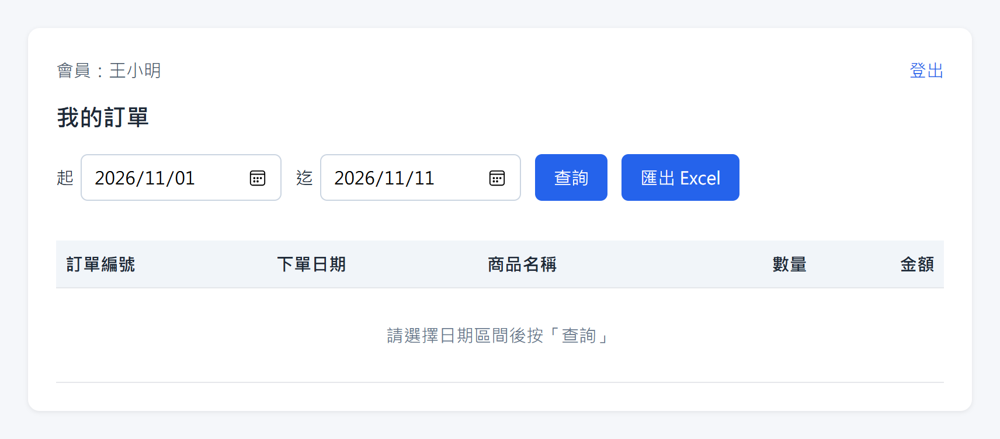
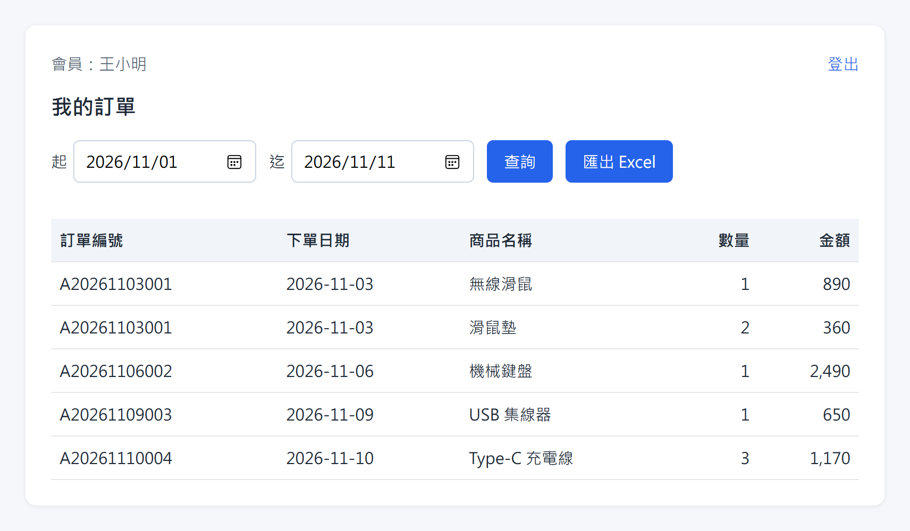
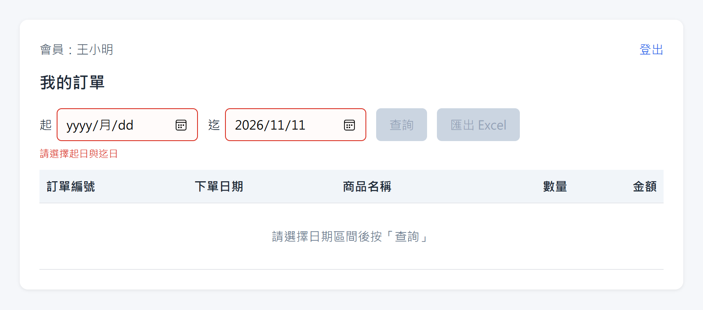
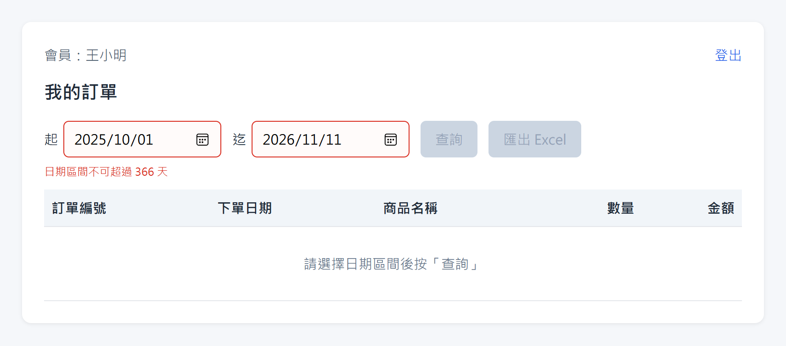
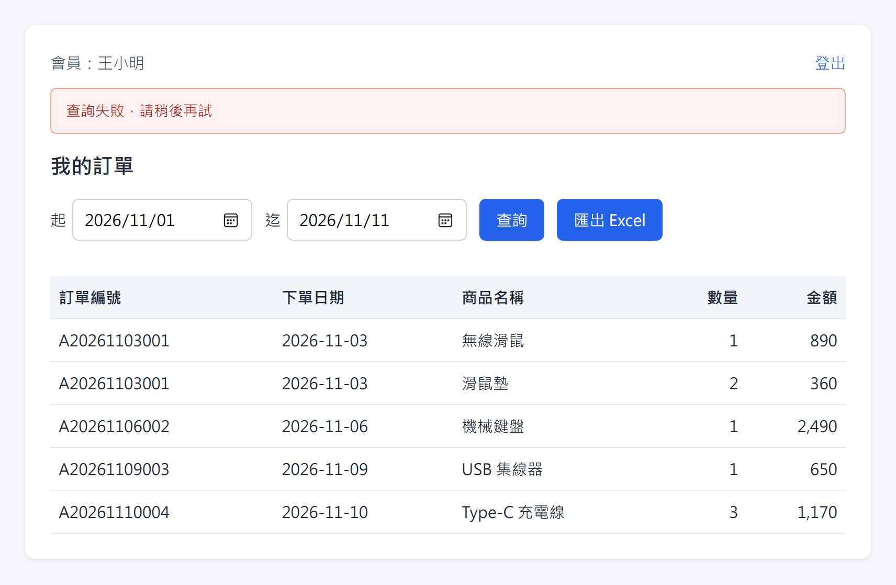
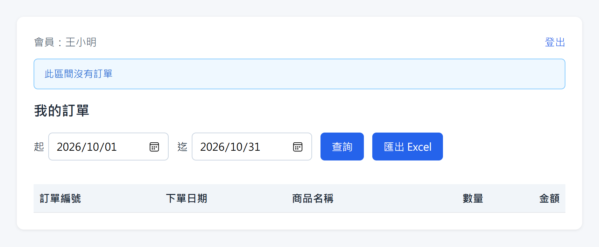
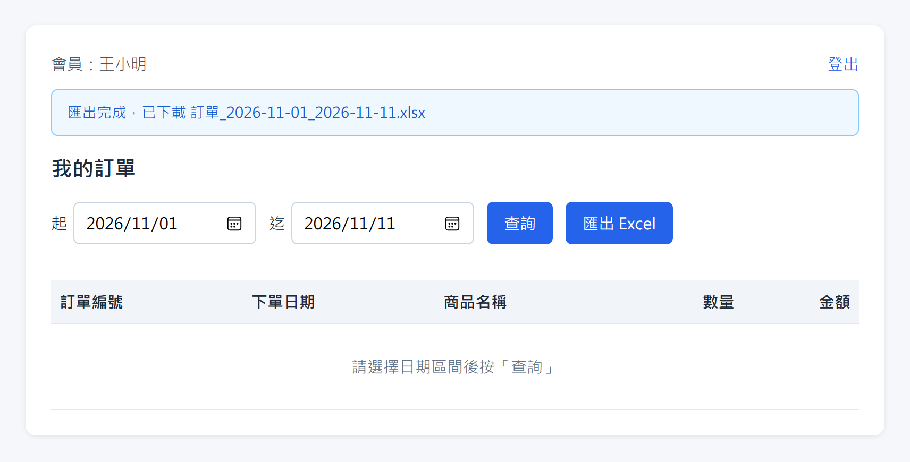
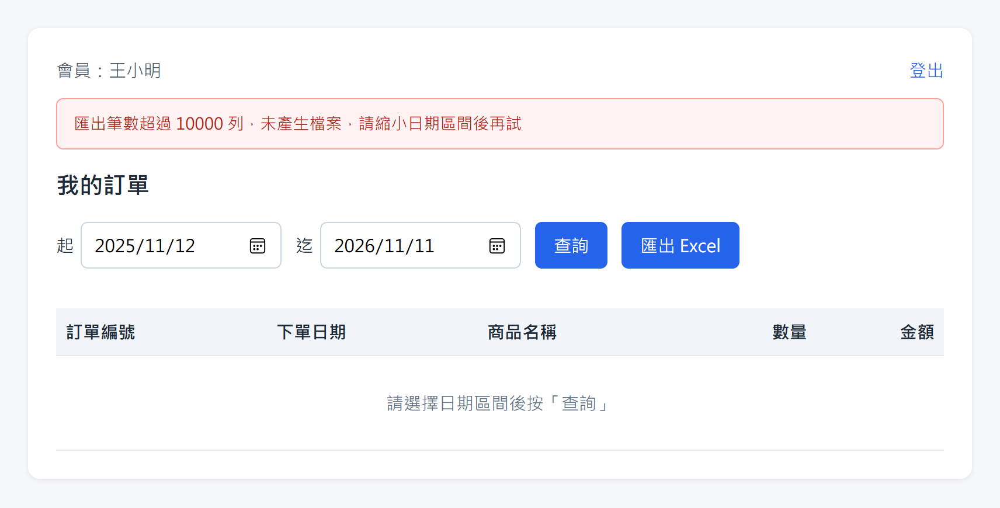
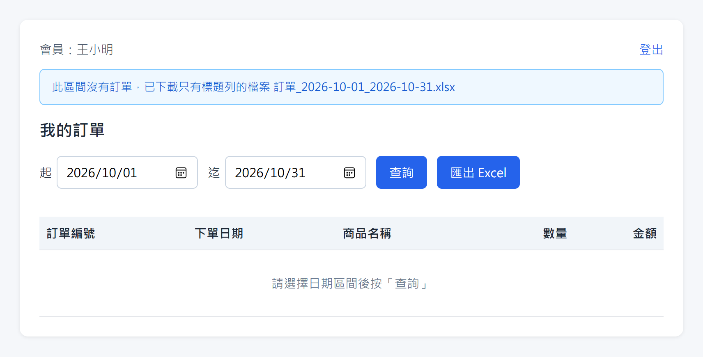
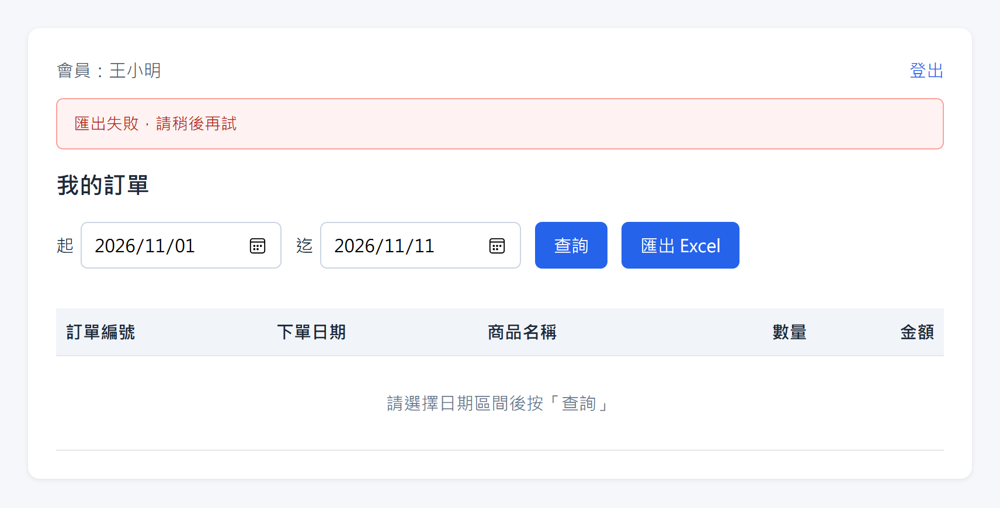

# 會員匯出訂單 Excel：需求說明

| 項目 | 內容 |
| --- | --- |
| 功能名稱 | 會員匯出訂單 Excel |
| 文件版次 | 0.4 |
| 系統分析者 | 系統分析師 |
| 審查者 |  |

## 版本管控歷程

| 版次 | 發行日期 | 修訂說明 | 修訂單位 | 修訂人員 |
| --- | --- | --- | --- | --- |
| 0.1 | 2026/11/10 | 初版 | 示範團隊 | 系統分析師 |
| 0.2 | 2026/11/10 | 補充：金額為每項商品小計、日期區間上限 366 天、單次最多匯出 10000 列、迄日包含當天、檔名格式、未登入時的處理、日期預設值、列表隨日期區間更新、區間內沒有訂單時的處理 | 示範團隊 | 系統分析師 |
| 0.3 | 2026/11/12 | 新增「查詢」按鈕：改為按「查詢」才查詢列表，進入頁面不自動查詢（顯示引導文字）、改日期也不自動查詢，列表保留上次查詢結果；「匯出 Excel」依日期欄位目前的值匯出，不需先查詢；日期有誤時「查詢」與「匯出 Excel」都不能按；查詢或匯出處理中的鎖定規則；補充查詢失敗、區間沒有訂單與匯出成功的提示；畫面加入會員名稱與登出 | 示範團隊 | 系統分析師 |
| 0.4 | 2026/11/13 | 註明日期欄位使用的控制項型態（瀏覽器內建的日期選擇器），截圖皆以原生日期欄位重新截取 | 示範團隊 | 系統分析師 |

## 功能目的
會員可以在「我的訂單」頁面選擇一段日期區間，按「查詢」查看自己這段期間的訂單，也可以按「匯出 Excel」把這段期間的訂單匯出成 Excel 檔案，方便留存或報帳。

## 畫面

畫面右上角顯示目前登入的會員名稱與「登出」連結。上方有「起」「迄」兩個日期欄位（瀏覽器內建的日期選擇器）、「查詢」與「匯出 Excel」兩個按鈕，下方是訂單列表，列出訂單編號、下單日期、商品名稱、數量、金額。剛開啟頁面時尚未查詢，日期欄位帶入預設區間，列表區只顯示引導文字，不顯示訂單。

## 操作說明
1. 會員開啟「我的訂單」頁面，日期預設為「本月 1 日」到「今天」，列表區顯示「請選擇日期區間後按「查詢」」，頁面不會自動查詢。
2. 會員可以改變「起」或「迄」日期；改日期不會自動查詢，列表保留上次查詢的結果。
3. 會員按下「查詢」，列表更新為日期欄位目前區間內的訂單。
4. 會員按下「匯出 Excel」，瀏覽器開始下載檔案；匯出依日期欄位目前的值，不需要先按「查詢」。
5. 查詢處理中，日期欄位鎖住不能修改，「查詢」與「匯出 Excel」暫時不能按；匯出處理中，「查詢」與「匯出 Excel」暫時不能按。

## 日期區間規則

| 規則 | 說明 |
| --- | --- |
| 日期控制項 | 「起」「迄」使用瀏覽器內建的日期選擇器（點選欄位彈出月曆挑選日期），日期的顯示格式依使用者瀏覽器語系而定；截圖以繁體中文（zh-TW）瀏覽器重新截取，日期欄位顯示為「年/月/日」（例如 2026/11/01）、右側帶行事曆圖示，未選日期時顯示 yyyy/月/dd 的空白格式 |
| 必須選擇 | 起日與迄日都必須選擇 |
| 起迄順序 | 起日不可晚於迄日 |
| 區間長度 | 最長 366 天（起日與迄日都算進去） |
| 迄日範圍 | 包含當天，也就是迄日當天下的訂單也會在區間內 |
| 日期有誤時 | 「查詢」與「匯出 Excel」都暫時不能按 |

## 查詢與列表規則

| 項目 | 內容 |
| --- | --- |
| 查詢時機 | 只有按「查詢」才會查詢；進入頁面與改日期都不會查詢 |
| 尚未查詢 | 列表區顯示「請選擇日期區間後按「查詢」」，不顯示訂單 |
| 改日期之後 | 列表保留上次查詢的結果，直到再次按「查詢」 |
| 查詢範圍 | 只查詢會員本人的訂單 |
| 列表欄位 | 訂單編號、下單日期、商品名稱、數量、金額 |
| 排列順序 | 依下單日期由舊到新 |
| 區間內沒有訂單 | 訊息區顯示「此區間沒有訂單」，列表不顯示任何訂單 |
| 查詢處理中 | 日期欄位鎖住，「查詢」與「匯出 Excel」不能按，按鈕文字顯示「處理中…」 |

## 匯出檔案內容

| 項目 | 內容 |
| --- | --- |
| 檔名 | 訂單_起日_迄日.xlsx |
| 匯出範圍 | 只匯出會員本人的訂單，區間依日期欄位目前的值，不要求先查詢 |
| 欄位 | 訂單編號、下單日期、商品名稱、數量、金額 |
| 一張訂單有多項商品 | 每項商品各占一列，訂單編號與下單日期重複顯示；金額是該項商品的小計，不會重複計算 |
| 金額格式 | 整數元，並以逗號分隔千位 |
| 日期格式 | 年-月-日 |
| 排列順序 | 依下單日期由舊到新 |
| 筆數上限 | 單次最多匯出 10000 列，超過時不產生檔案 |
| 區間內沒有訂單 | 仍會下載只有標題列的檔案 |
| 匯出處理中 | 「查詢」與「匯出 Excel」不能按，按鈕文字顯示「處理中…」；日期欄位不鎖住 |

## 輸入日期時的提示
選擇或修改日期的當下就會出現，不需要按任何按鈕。提示文字顯示在日期欄位下方，欄位框變紅，「查詢」與「匯出 Excel」按鈕暫時不能按，列表維持原來的內容。

**沒有選擇起日或迄日**

**起日晚於迄日**

**區間超過 366 天**

## 按下「查詢」之後的提示
按下按鈕後，日期欄位鎖住，「查詢」與「匯出 Excel」暫時不能按；結果出來後，提示顯示在頁面上方的訊息區。

**查詢處理中**

**查詢失敗**（列表維持原來的內容）

**區間內沒有訂單**

## 按下「匯出 Excel」之後的提示
按下按鈕後，「查詢」與「匯出 Excel」暫時不能按；結果出來後，提示顯示在頁面上方的訊息區，列表維持原來的內容。

**匯出處理中**

**匯出成功**

**匯出筆數超過 10000 列**（不產生檔案）

**區間內沒有訂單**（仍會下載只有標題列的檔案）

**匯出失敗**

## 未登入時的提示
**尚未登入或登入已失效（無畫面）**：前往登入頁，登入後回到「我的訂單」頁面。
