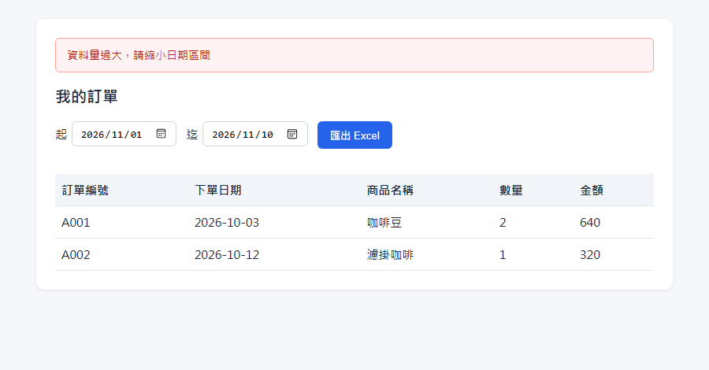
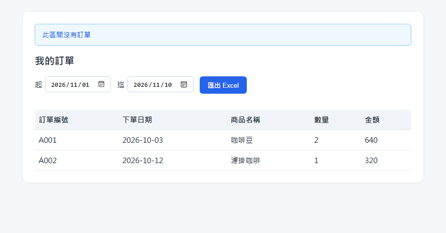
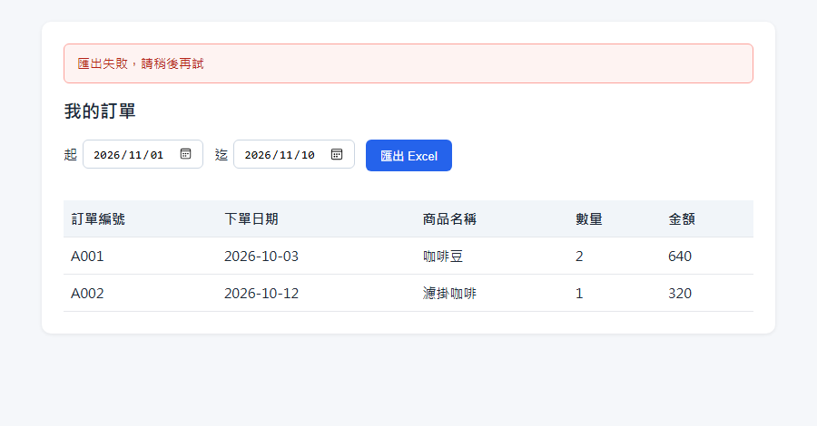

# 會員匯出訂單 Excel：需求說明

| 項目 | 內容 |
| --- | --- |
| 功能名稱 | 會員匯出訂單 Excel |
| 文件版次 | 0.2 |
| 系統分析者 | 系統分析師 |
| 審查者 |  |

## 版本管控歷程

| 版次 | 發行日期 | 修訂說明 | 修訂單位 | 修訂人員 |
| --- | --- | --- | --- | --- |
| 0.1 | 2026/11/10 | 初版 | 示範團隊 | 系統分析師 |
| 0.2 | 2026/11/10 | 補充：金額為每項商品小計、日期區間上限 366 天、單次最多匯出 10000 列、迄日包含當天、檔名格式、未登入時的處理、日期預設值、列表隨日期區間更新、區間內沒有訂單時的處理 | 示範團隊 | 系統分析師 |

## 功能目的
會員可以在「我的訂單」頁面選擇一段日期區間，把自己這段期間的訂單匯出成 Excel 檔案，方便留存或報帳。

## 畫面

畫面上方有「起」「迄」兩個日期欄位和「匯出 Excel」按鈕，下方是訂單列表，列出訂單編號、下單日期、商品名稱、數量、金額。

## 操作說明
1. 會員開啟「我的訂單」頁面，日期預設為「本月 1 日」到「今天」，下方列表顯示這段期間的訂單。
2. 會員可以改變「起」或「迄」日期，下方列表會立即更新成新區間的訂單。
3. 會員按下「匯出 Excel」，瀏覽器開始下載檔案。

## 日期區間規則

| 規則 | 說明 |
| --- | --- |
| 必須選擇 | 起日與迄日都必須選擇 |
| 起迄順序 | 起日不可晚於迄日 |
| 區間長度 | 最長 366 天（起日與迄日都算進去） |
| 迄日範圍 | 包含當天，也就是迄日當天下的訂單也會在區間內 |

## 匯出檔案內容

| 項目 | 內容 |
| --- | --- |
| 檔名 | 訂單_起日_迄日.xlsx |
| 匯出範圍 | 只匯出會員本人的訂單 |
| 欄位 | 訂單編號、下單日期、商品名稱、數量、金額 |
| 一張訂單有多項商品 | 每項商品各占一列，訂單編號與下單日期重複顯示；金額是該項商品的小計，不會重複計算 |
| 金額格式 | 整數元，並以逗號分隔千位 |
| 日期格式 | 年-月-日 |
| 排列順序 | 依下單日期由舊到新 |
| 筆數上限 | 單次最多匯出 10000 列，超過時不產生檔案 |

## 輸入日期時的提示
選擇或修改日期的當下就會出現，不需要按「匯出 Excel」。提示文字顯示在日期欄位下方，欄位框變紅，「匯出 Excel」按鈕暫時不能按，下方訂單列表維持原來的內容。

**沒有選擇起日或迄日**

**起日晚於迄日**

**區間超過 366 天**

## 按下「匯出 Excel」之後的提示
按下按鈕後，按鈕會顯示處理中並暫時不能按；結果出來後，提示顯示在頁面上方的訊息區，訂單列表維持原來的內容。

**匯出筆數超過 10000 列**（不產生檔案）

**區間內沒有訂單**（仍會下載只有標題列的檔案）

**匯出失敗**

**尚未登入或登入已失效（無畫面）**：前往登入頁，登入後回到「我的訂單」頁面。
