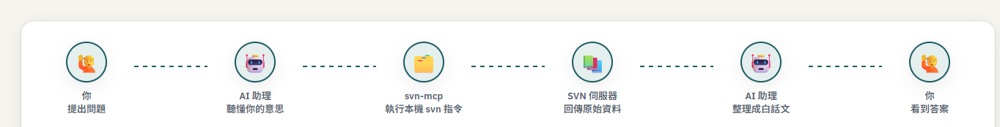
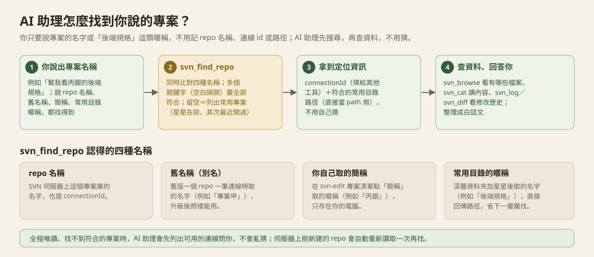
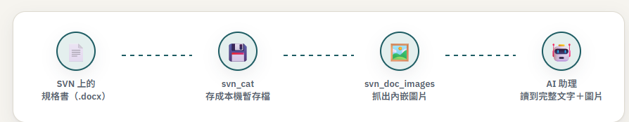
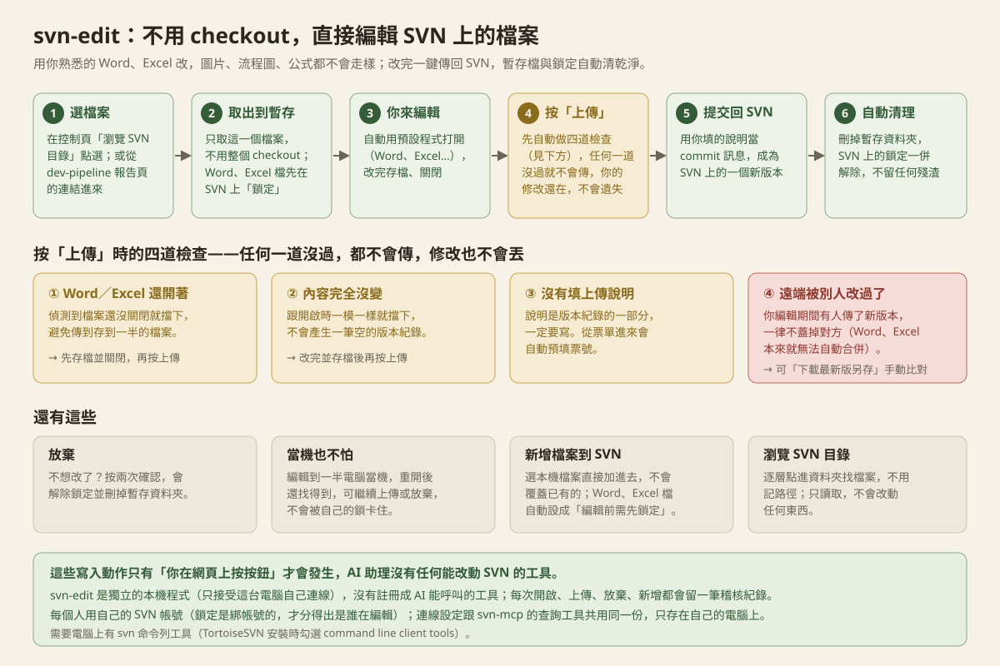

# svn-mcp

讓 AI 助理幫你查 SVN 上的程式碼跟規格文件：有哪些檔案、檔案內容長怎樣、改過什麼、跟上一版差在哪。**AI 助理能呼叫的工具對 SVN 完全唯讀**，不會幫你改動或刪除任何東西。直接執行本機的 `svn` CLI，不依賴 claudeweb 或任何網站服務——stdio 工具（下表）跟 claudeweb 完全無關。另外附一個**給人用的網頁編輯器 `svn-edit`**（見下方「遠端單一檔案編輯」一節）：它的寫入動作只有使用者在網頁上按按鈕才會發生，**AI 沒有任何工具能碰到**。

## 這是怎麼運作的



連線設定只需要登記「SVN 帳號」（伺服器上層網址＋帳密），這個帳號看得到的所有 repo 會自動帶出來，不用一個一個登記；可以同時登記好幾個帳號。使用者口中的專案名稱可能是 repo 名稱、舊名稱、自己取的簡稱或常用目錄暱稱，AI 助理會先呼叫 `svn_find_repo` 搜尋定位，找不到或有多個像的時候先問你，不會亂猜。


**連線資料只有一份**：帳號與帳密只在 svn-edit 的「連線設定」管理，全部存在 `info/svn-connections.json`。AI 助理（svn-mcp 唯讀工具）、票單流程（dev-pipeline-mcp，轉呼叫 svn-mcp）、claudeweb 網站（經下方的 HTTP bridge）都是「讀取」，沒有各自的連線副本；claudeweb 只拿得到不含帳密的連線清單，執行時用 `connectionId` 請 svn-mcp 代跑，帳密不離開 svn-mcp。



## 讀規格書的完整流程

規格書（SA/SD）常常用 Word 文件撰寫，畫面設計、流程圖多半是用圖片貼進去的——只讀文字內容會漏掉這些關鍵資訊：



---

想要更完整、連非技術人員都看得懂的說明（含使用情境範例、常見問題），請見 **[docs/MANUAL.html](docs/MANUAL.html)**（排版過的網頁，GitHub 網頁上點開只會看到原始碼，要下載下來用瀏覽器打開才看得到排版後的樣子）。以下是給負責設定的人看的技術細節。

> **注意**：這份 README 曾經描述過一個更早期的架構（stdio 工具轉呼叫 claudeweb 的 SVN REST API，靠 `SVN_API_BASE` 指定 claudeweb 網址）。目前原始碼（`src/svn-client.ts`）已經沒有這個機制、也沒有讀取 `SVN_API_BASE` 這個環境變數了——已更新成下方實際的樣子。真正還會呼叫 claudeweb 的是另一個獨立元件，見下方「HTTP bridge」一節。

## 工具

全部對 SVN 唯讀。共 3 大類、8 個工具，點下面展開完整清單：

<details>
<summary>📋 展開完整工具清單（3 大類・8 個）</summary>

| 分類 | 工具 | 對應 `svn` 子命令 / 說明 |
|---|---|---|
| 連線管理 | `svn_list_connections` | 列出所有可用的連線（每個 repo 一筆：`id`／`name`／`url`／`aliases`，另附簡稱、是否加星星、常用目錄；不含帳號密碼） |
| 連線管理 | `svn_find_repo` | 依關鍵字找專案庫：同時比對 repo 名稱、舊名稱（別名）、簡稱、常用目錄的暱稱與路徑，多個關鍵字用空白隔開要全部符合，留空＝列出常用專案（星星在前、其次最近開過）；回傳 `connectionId` 與符合的常用目錄路徑（`path` 可直接填給其他工具）。找不到且帳號的 repo 清單快取已過期時，會向伺服器重讀一次再找 |
| 連線管理 | `svn_test_connection` | 實際測試某個連線連不連得上（真的執行一次查詢） |
| 瀏覽與讀取 | `svn_browse` | `svn list`，列出某個路徑底下的檔案/資料夾 |
| 瀏覽與讀取 | `svn_cat` | `svn cat`，讀取檔案內容；文字檔直接回傳，Word/Excel/PDF 存成暫存檔交給既有文件讀取流程處理 |
| 瀏覽與讀取 | `svn_doc_images` | 把 Word/Excel 文件存成暫存檔，交給既有流程抽取內嵌圖片 |
| 修改歷史 | `svn_log` | `svn log`，查詢修訂記錄 |
| 修改歷史 | `svn_diff` | `svn diff`，比較兩個版本之間的差異 |

</details>

常見查詢鏈：使用者提到專案名稱或要找規格存放位置 → **先 `svn_find_repo`**（不要自己猜 connectionId 或路徑）→ 把 `hits[].connectionId` 與 `hits[].folders[].path` 帶進其他工具；完全不知道有哪些專案時再用 `svn_list_connections` 看完整清單。`connectionId` 可以填 repo 名稱、別名或舊 id。讀 docx/xlsx 規格書時，`svn_cat` 讀文字之後記得再呼叫 `svn_doc_images` 讀圖片，畫面設計/流程圖常常只在圖片裡。

## 環境變數（stdio 工具）

| 變數 | 說明 | 預設值 |
|---|---|---|
| `SVN_CONNECTION_ID` | 預設使用的 SVN 連線 ID（沒指定就用這個） | 無（工具呼叫需自行指定連線） |
| `SVN_CONNECTIONS_FILE` | 單一設定檔路徑（帳號 url/username/password，加上 repo 清單快取與個人偏好，見下方「共用設定檔」） | 這個 MCP 自己目錄下的 `info/svn-connections.json` |
| `SVN_TIMEOUT_MS` | 執行 `svn` 指令的逾時毫秒數 | `30000` |

## HTTP bridge（`src/http-server.ts`，給 claudeweb 用的獨立介面）

跟上面的 stdio 工具是兩條完全不同的路——這是給 `claudeweb`（Java Web App，`C:\Tool\claudeweb`）依賴的持久化 HTTP 服務，讓它能對 `svn` CLI 下指令而不用自己重新實作一份。`claudeweb` 這邊透過 `svn.mcp.http.base`（預設 `http://localhost:9095`）呼叫，兩者設計上跑在同一台機器（`claudeweb` 會用 `ProcessBuilder` 直接在本機拉起 `dist-exe/svn-http-bridge.exe`）。

| 變數 | 說明 | 預設值 |
|---|---|---|
| `SVN_MCP_HTTP_PORT` | 監聽的埠號 | `9095` |
| `SVN_BRIDGE_HOST` | 綁定的網路介面 | `127.0.0.1`（只接受本機連線） |
| `SVN_BRIDGE_TOKEN` | 選配的共用密鑰，設定後 `POST /run` 要求 `Authorization: Bearer <token>` | 未設定（不驗證，僅靠 host 綁定防護） |

**連線資料只在 svn-mcp 這邊維護**（`info/svn-connections.json`，用 svn-edit 的「連線設定」管理）；claudeweb 不存連線資料，也拿不到帳密：

| 端點 | 說明 |
|---|---|
| `GET /connections` | 列出所有連線（每個 repo 一筆；id、name、url、nickname、aliases、starred、folders，**不含帳密**） |
| `GET /connection?id=` | 查單一連線，`id` 可以是連線 id、repo 名稱、舊版 id（`legacyIds`）、別名或簡稱；找不到回 404 |
| `POST /run` | 本體 `{ connectionId, args, timeoutMs? }`：svn-mcp 解析連線、自己附上帳密後執行；`args` 是 `svn` 後面的參數（不含帳密） |
| `GET /health` | 健康檢查 |

`POST /run` 只允許 `list`/`ls`/`cat`/`log`/`diff`/`info` 這幾個唯讀子命令，且拒絕任何 `file://` 開頭的參數；以 `connectionId` 呼叫時，所有 URL 參數都必須在該連線的 URL 底下（帳密不能拿去打別的主機），`args` 也不可自帶 `--username`／`--password`。舊的 `{ args }`（帳密已寫在參數裡）形式仍可用，僅為相容舊呼叫端。這是給 claudeweb 瀏覽/讀取 SVN 用的橋接，不是任意執行 `svn` 指令的通道。

執行檔版（`dist-exe/svn-http-bridge.exe`）直接由 `src/http-server.ts` 打包（`npm run build:exe`，會先跑 `bundle:bridge`），不再另外維護一份複製的 `pkg/http-server.cjs`。

## 工作副本操作（不是 MCP 工具，AI 碰不到）

`src/workcopy-client.ts` 提供對本機 SVN 工作副本的 `status`／`diff`／`add + commit`／`update`／`delete`／`revert`／`cleanup` 函式，給 [`dev-pipeline-mcp`](../dev-pipeline-mcp) 的待人工處理報告網頁按鈕使用（使用者在網頁上勾選、填 commit 訊息、按上傳）。**這些函式刻意沒有註冊成任何 MCP 工具**——上面「工具」清單仍然是 AI 唯一能用的，全部唯讀；`tests/read-only-surface.test.mjs` 會鎖住註冊的工具清單，並檢查 `index.ts`／`*-tools.ts` 不得引用這個模組。

安全邊界：
- 工作副本必須真的是 SVN working copy，且遠端 URL 必須在指定連線的 URL 底下（以 `/` 為邊界比對，`.../repo2` 不算在 `.../repo` 底下）。
- 檔案路徑一律是相對於工作副本的路徑，不能是絕對路徑、不能含 `..` 或 `.svn`。
- commit 一律明確列出檔案（不會整份工作副本全部送出）、必須有非空訊息；中文訊息寫成 UTF-8 暫存檔以 `-F` 傳給 svn（直接用 `-m` 在 Windows 上會被轉成系統字碼頁而失敗）。
- commit 前會先把「新檔案」加入版控；commit 失敗會把這次剛做的加入動作還原（檔案內容不動）。
- 遇到衝突（含 tree conflict）一律拒絕、`update` 一律 `--accept postpone`，不自動解決；`~$` 開頭的 Office 暫存鎖定檔不列出、也不會被加入。
- `revert` 只允許用在新增／刪除／遺失三種狀態，不會丟掉任何已修改的內容——對資料夾是遞迴還原，所以底下只要有已修改的檔案就拒絕（以 `svn copy` 加入且沒修改過的資料夾，還原會移除那份複本，原件不受影響）；有未上傳修改的檔案不能直接標記刪除。
- 同一份工作副本的操作會排隊執行（SVN 對同一份工作副本平行操作會鎖死）。

測試：`npm test`（build 後跑 `node --test`）。工作副本的測試用本機臨時 SVN 儲存庫（`svnadmin create` + `file://`），不連任何真實 SVN，需要本機有 `svn`／`svnadmin`（TortoiseSVN 的 bin 目錄）。

## 遠端單一檔案編輯：svn-edit（不是 MCP 工具，AI 碰不到）

讓使用者不用手動 checkout，就能把 SVN 上的一個檔案（`.docx`／`.xlsx`／`.xls`／`.md`／`.txt`／`.csv`）取到暫存資料夾、用本機的軟體改完（md 用 VS Code、csv 用記事本，其餘用預設程式；只影響 svn-edit 自己開檔，不改檔案關聯），再上傳回 SVN。`.pdf` 只能開啟檢視（唯讀）。設計文件見 [docs/svn-edit-design.md](docs/svn-edit-design.md)。



- **核心**：`src/remote-edit-client.ts`（開啟、上傳、放棄、當機復原、衝突時另存最新版），跟 `workcopy-client.ts` 一樣**刻意沒有註冊成任何 MCP 工具**，`tests/read-only-surface.test.mjs` 會檢查 `index.ts`／`*-tools.ts` 不得引用。
- **入口**：`svn-edit` 本機服務（`src/edit-main.ts` → 打包成 `dist-exe/svn-edit.exe`），只綁 `127.0.0.1`，預設埠 `9097`。手動雙擊執行檔會用 Edge 的「應用程式視窗」模式（`--app`，無網址列，使用專屬設定資料夾 `%LOCALAPPDATA%\SVN遠端編輯\edge`，找不到 Edge 退回預設瀏覽器）開出獨立的桌面視窗（`src/edit-window.ts`），視窗與 exe 都有專屬圖標（`assets/totoro.ico`）；已有實例在跑時會把既有視窗叫到最前面，不重複開。控制頁網址為 `http://127.0.0.1:9097/`；dev-pipeline 網頁按鈕只需要開啟 `http://127.0.0.1:9097/edit?connection=<連線名稱>&path=<遠端路徑>&ticket=<票號>`，服務會先顯示確認頁，使用者按「開始編輯」才真的取出檔案（GET 永遠不會改動任何狀態）。
- **自動拉起**：svn-mcp 啟動時會先檢查 `/health`，沒有在跑就拉起 svn-edit（冪等，已在跑就略過）。Windows 上透過 PowerShell 的 `Start-Process` 建立，確保服務不會握著 svn-mcp 的 MCP 通訊管道；沒有使用 Claude Code 的人可以直接雙擊 `svn-edit.exe`。
- **共用設定檔（單一檔案）**：svn-edit 與 svn-mcp 唯讀工具**共用同一份** `info/svn-connections.json`（`SVN_CONNECTIONS_FILE` 優先；執行檔預設讀「執行檔上一層」的 `info/`，不進版控）。格式 v2，一個檔案三塊資料：`accounts`（SVN 帳號）、`repoCache`（各帳號最近讀到的 repo 清單，只是快取）、`prefs`（星星、簡稱、最近開過、常用目錄與暱稱、同步本地端的開關與各專案的本地目錄）；檔案最前面有 `_readme` 說明，AI 打開檔案就知道每一塊是什麼、該呼叫 `svn_find_repo`（不要自己讀檔、不要輸出 password）。**寫入一律走「跨程式檔案鎖 → 重讀 → 套用變更 → 原子寫回（`src/profile-store.ts`、`src/atomic-write.ts`）」**，svn-edit 與 MCP 工具是不同程式，誰先誰後都不會互相蓋掉對方剛寫的內容；檔案壞掉（不是合法 JSON）時拒絕寫入，不會覆蓋。**舊格式自動升級**：舊版是三個檔案（連線陣列、`svn-repos-cache.json`、`svn-repo-prefs.json`），第一次寫入時會先備份原檔成 `svn-connections.backup-v1-時間.json`、把旁邊兩個舊檔改名成 `.merged.bak`，再寫成 v2（舊格式也讀得進來，會自動併入旁邊兩個檔案的內容）。每位同事請使用自己的 SVN 帳號（SVN 的鎖是綁帳號的）。
- **誰讀這份檔案**：svn-mcp 的唯讀工具、svn-edit、dev-pipeline-mcp（轉呼叫 svn-mcp）、以及 claudeweb（經 HTTP bridge 的 `GET /connections`、`POST /run`）。claudeweb 不再有自己的連線檔。要讓舊系統留下的連線 id 繼續能用，把它寫進帳號的 `legacyIds`（舊 id → repo 名稱），`svn_*` 工具與 bridge 都查得到。
- **svn 輸出的編碼**：繁中 Windows 上 `svn.exe` 的訊息、日期、路徑是 cp950，但 `svn diff` 內文是檔案原始位元組（通常 UTF-8），同一份輸出會混雜兩種編碼。`src/svn-text.ts` 的 `decodeSvnText` 逐行判斷（合法 UTF-8 照用，否則當 Big5），套用在 stderr、`svn info`、`svn diff` 與工作副本的 diff／update；`--xml` 輸出一律 UTF-8，不經過它。
- **專案選擇（瀏覽 SVN 目錄與新增檔案共用）**：專案很多時（有人的帳號底下有 70 幾個 repo）不用在長長的下拉選單裡找。「瀏覽 SVN 目錄」按下去先看到專案清單：**近期 SVN**（最近點開的在最上面）與**星星 SVN**（★ 的專案放在最上面，可拖曳 ⋮⋮ 調整順序）兩個分頁，上方有搜尋框（名稱、舊別名、簡稱都會比對，多個關鍵字用空白隔開）與重新載入鈕（向所有帳號重讀 repo 清單），每列可點 ☆ 加星星、點右側「簡稱」替專案取自己的暱稱；點專案進入目錄，「← 專案清單」回來。「新增檔案到 SVN」的「連線」也改成同樣可搜尋的專案選單（星星在最上面、其次是最近開過的），簡稱與星星跟瀏覽面板**共用同一份資料**，一邊改另一邊馬上同步；**換專案時「放到 SVN 的哪裡」會自動清空**，「從 SVN 選擇」面板開著就立刻改列新專案的根目錄。星星、排序、最近開過、簡稱存在共用設定檔的 `prefs` 區塊（`src/repo-prefs.ts`＋`src/prefs-model.ts` 的整理規則，個人偏好、不進版控；以專案名稱當 key，公司換網址也不會掉）；**簡稱與帳號項目裡的「別名」是兩回事**——別名是給 dev-pipeline 等工具用舊名稱查找連線用的，不會被畫面改掉，簡稱沒設時才顯示別名當提示。API：`POST /api/repo-prefs/star`／`reorder`／`open`／`nickname`、`POST /api/servers/refresh-all`；`GET /api/state` 多一個 `repoPrefs`。**AI 也讀得到這些偏好**（唯讀）：`svn_find_repo`／`svn_list_connections` 會回傳簡稱、星星與常用目錄，使用者說「丙銀」就能直接定位，不需要把偏好另外告訴 AI。svn-edit 啟動時也會自動補齊「還沒有 repo 清單快取」的帳號。
- **常用目錄（每個專案各自的星星目錄）**：經常要把規格傳到某幾個深層資料夾時，在「從 SVN 選擇資料夾」面板裡，每個資料夾列左邊的 ☆、以及底下「目前位置」旁的 ☆ 都能把那個目錄加入**這個專案**的常用目錄（每個專案各自一份、互不影響）；加了之後面板最上面會出現「★ 常用目錄」區，點路徑直接跳到那個資料夾、按「使用」直接把它填進「放到 SVN 的哪裡」並關閉面板，不用一層一層點。路徑很長時可以按「取暱稱」替目錄取個好認的名字（例如「後端規格」，最多 30 字）；暱稱只能取在「已經是常用目錄」的路徑上，取消星星時一併清掉。存在共用設定檔 `prefs` 的 `folders`（專案名稱 → 目錄清單，每個專案最多 100 個，路徑拒絕 `..`、Windows 不允許的字元）與 `folderNicknames`（專案名稱 → 路徑 → 暱稱），API：`POST /api/repo-prefs/folder`、`POST /api/repo-prefs/folder-nickname`。`svn_find_repo` 會比對暱稱與路徑，並把符合的常用目錄 `path` 直接回傳給 AI。
- **連線設定：只管「帳號」（填帳密就能用所有 repo）**：連線設定只有一種——SVN 帳號。填伺服器的**上層網址**（Apache `SVNParentPath`，底下每個子目錄是一個 repo，例如 `https://svn.example.com/svn`）、名稱、帳號、密碼，就會自動讀出這個帳號看得到的所有 repo，瀏覽、編輯、批次上傳與 svn-mcp 的唯讀工具（`svn_browse`／`svn_cat`／`svn_log`／`svn_diff`…）都直接能用。畫面主卡片只列帳號（有幾個帳號就幾筆），按「管理連線」往右延伸出面板：每個帳號可**編輯**（名稱、網址、帳號、密碼，公司換網址時用）、**重新載入**（伺服器新增 repo 時）、**刪除**（連同它的 repo 清單快取，不會動 SVN 上的資料）；表單有「測試連線」，而且**新增與更新儲存前一定會先實際連線測試**，連不上就不存並顯示原因，成功會顯示找到幾個 repo 與驗證方式（公司 SVN 是 Windows 整合驗證時，實際用的是目前登入電腦的帳號，填的密碼沒有被用到）。共用設定檔的 `accounts` **只存帳號**（`kind: "server"`：id、name、url、username、password，另有給舊名稱用的 `aliases`／`legacyIds`）；底下有哪些 repo 放在同一個檔案的 `repoCache` 區塊（`src/repo-cache.ts`），快取不見或壞了會自動向伺服器重讀；唯讀工具找不到 repo 時（快取超過 10 分鐘）也會自動重讀一次，同一個帳號 60 秒內最多重讀一次（伺服器連不上時，連續打錯名稱不會每次都卡 30 秒）。**別名**：舊版一個 repo 一筆連線時取的名稱（例如「專案甲」）與舊連線 id（例如 `20733443`）會保留成帳號項目裡的別名對照，其他工具（dev-pipeline 的 `svnConnectionId` 設定）照舊用這些名稱找連線，且用的仍是當初那個帳號的帳密；別名也顯示在畫面的 repo 下拉選單與 `svn_list_connections`（`aliases` 欄位），`connectionId` 可以填 repo 名稱、展開後的 id、別名、舊 id，或使用者自己取的簡稱（同一個簡稱只對到一個專案時；重複就視為找不到，不會猜）。**舊連線自動遷移**：svn-edit 啟動時若發現舊的連線格式（每個 repo 一筆），會把「上層網址＋帳號（不分大小寫）相同」的併成一個帳號、舊名稱與舊 id 轉成別名，並先備份成 `info/svn-connections.backup-時間.json`；要新增帳號的會先實際連線確認，連不上就維持原樣不轉。純函式在 `src/connection-expand.ts`（唯讀工具也會用），讀寫在 `src/connections-store.ts`。API：`POST /api/servers`（儲存，網址＋帳號相同視為更新同一個帳號）、`/api/servers/test`（只測不存）、`/api/servers/refresh`、`/api/servers/delete`；`GET /api/state` 的 `servers` 是帳號、`connections` 是展開後的 repo（含 `aliases`），都不含密碼。**公司換網址**時，在管理連線面板編輯那個帳號的網址即可，簡稱、星星、常用目錄都不會掉。repo 清單來自對上層網址的 HTTP GET（Apache 回傳 XML 索引，標題固定是 `Collection of Repositories`；`svn list` 對上層網址不行，會回 E175003），由 `src/server-repos.ts` 用 Windows 內建的 `System32\curl.exe`（`--anyauth`）取得，帳密經 stdin 傳給 curl，不會出現在命令列。只有 svn-edit 能新增／修改／刪除帳號（寫入連線檔），唯讀 MCP 工具只讀；MCP 工具唯一會寫的是自動補的 `repoCache` 區塊（只是快取，不動帳號與偏好）。
- **Windows 整合驗證**：如果伺服器用 Windows 登入驗證（Negotiate／NTLM，公司內網常見），帳密其實不會被用到——svn 與 curl 都會直接用你登入電腦的 Windows 帳號，連亂填帳號密碼 svn 也照樣通過。所以伺服器的帳號、密碼可以留空（帳號預設為目前的 Windows 使用者）；讀取 repo 清單時會先用填的帳密，被 401 拒絕再改用 Windows 登入身分，畫面上會註明是哪一種。這代表在這類伺服器上，「誰在操作」取決於 Windows 登入者，而不是連線檔裡的帳號。
- **瀏覽 SVN 目錄**：控制頁的「瀏覽 SVN 目錄」卡片可以逐層點進資料夾，點可編輯的檔案（docx、xlsx、xls、md、txt、csv）就跳到確認頁、點 PDF（👁）直接開啟檢視，同事不用記路徑。完全唯讀（只用 `svn list`）。API 是 `GET /api/browse?connection=…&path=…`。網址帶 `?connection=<連線名稱>&browse=<起始目錄>&ticket=<票號>` 進入控制頁會自動展開並載入該目錄，票號會一路帶到確認頁、預填 commit 訊息，dev-pipeline 的按鈕只需要組出這種連結。
- **上傳檔案／資料夾（批次）**：控制頁的「新增檔案到 SVN」可一次選多個檔案或整個資料夾（也能拖曳，資料夾連同子資料夾、保留資料夾名稱），指定遠端目的地（可直接輸入，或按「從 SVN 選擇」在右側面板點選資料夾；不存在會自動建立），**只產生一個 commit**（核心在 `src/remote-import-batch.ts`，同樣刻意不註冊成 MCP 工具）。網頁逐檔送到暫存區 → 預覽哪些是新增、哪些會覆蓋 → 使用者確認後才送出。遠端已有的同名檔案會更新成新版本（內容相同的不產生變更，SVN 有歷史可還原）；遠端版本比本機檔案新時會另外顯示警告，需再按「我確認，仍要覆蓋」。做法是只 checkout 目標目錄最近的已存在祖先（depth empty），再逐一 update 要覆蓋的檔案，目標目錄再大也不影響速度。依副檔名自動設定屬性：docx／xlsx／xls 設 `svn:needs-lock`，md／txt 設 `svn:eol-style=native`（盡力而為：SVN 會把「小而全是中文」的文字檔誤判成二進位而拒絕設定，這種情況略過、不讓整批上傳失敗）。上限：單檔 50 MB、一次 300000 個檔案、總共 4 GB；`svn` 逾時會依檔案數與大小自動放寬（基本逾時＋每個檔案 0.6 秒＋每 MB 5 秒，上限 24 小時，svn 輸出緩衝同步加大），逾時時會明確回報「檔案數量或網路傳輸量太大，請分批上傳或調高 `SVN_TIMEOUT_MS`」，而不是只丟一串 exit code。API：`POST /api/import/start` → `POST /api/import/stage?batch=…&path=…`（檔案內容放請求本文，原始位元組）→ `POST /api/import/plan` → `POST /api/import/commit`（或 `POST /api/import/cancel` 放棄並清掉暫存）。舊的單檔 `POST /api/import?connection=…&path=…&message=…` 仍保留（遠端已有同名檔案拒絕、不覆蓋）。
- **一次編輯的流程**：取出單一檔案到專案的 `logs\<id>\`（docx、xlsx、xls 預設先 `svn lock`）→ 開啟（md 用 VS Code、csv 用記事本——避免 Excel 用 ANSI 存檔把 UTF-8 中文弄成亂碼，其餘用預設程式；VS Code 位置可用 `SVN_EDIT_VSCODE` 指定，沒設會找常見安裝位置，找不到退回預設程式）→ 使用者改完按「上傳」。檔案被關掉想再開，按卡片上的「重新開啟檔案」。上傳前檢查：Word／Excel 暫存鎖定檔（`~$`）還在就拒絕、內容沒變就拒絕、commit 訊息不能空、**遠端在你開啟後被別人更新就拒絕**（不自動合併，可「下載最新版另存」手動比對）。
- **升級版本（上傳時勾選）**：規格書檔名帶版本號（例如 `SPEC_MF04_營業人銷售額與稅額申報書_v0.7.docx`）時，編輯卡片的「升級版本」勾下去，上傳會在**同一個 commit** 做三件事：確保同目錄有 `old` 資料夾（遠端已有 `old`／`Old` 就沿用原本的大小寫，沒有就新建）→ 把開啟編輯當時的版本 `svn copy` 進去（保留歷史）→ 編輯好的檔案 `svn move` 成新檔名（`_v0.8`）。版本號規則（`src/version-bump.ts`）：取檔名（副檔名前）最後一個 `v數字.數字…`（大小寫 V 都行，前面不能緊接英數字，避免誤抓 `rev1.2`）；兩段版本最後一段 +1、遇 9 進位（`v0.9` → `v1.0`），三段以上只把最後一段 +1；原檔名沒有版本號時，新版自動加 `_v0.2`、放進 `old` 的舊版補 `_v0.1`。勾選後畫面會先預覽舊版與新版會放哪裡、新檔名可以自己改（要同副檔名、不能跟目錄裡既有檔案同名）；新檔名已存在、`old` 裡已有同名舊版時不能升級並說明原因。**中途任何一步失敗都會把工作副本還原、把你編輯好的內容放回去**，不會因為升級失敗弄丟編輯。API：`GET /api/upgrade-plan?id=…&newName=…`（預覽）、`POST /api/commit` 帶 `upgrade`（上傳）。
- **同步本地端（開關）與刪除遠端檔案**：使用者平常另外用 TortoiseSVN checkout 了一份本地工作目錄時，遠端改完要再手動 update 很容易忘；這個功能讓 svn-edit 在遠端寫入成功後自動幫你 `svn update`。**預設關閉**，關閉時行為跟以前完全一樣（只動遠端、不碰本機）。開關放在「管理連線」往右延伸的面板最下方「同步本地端」（一個切換開關）；開啟後才會出現**每個專案各自一個本地 SVN 工作目錄**的設定（完整路徑，例如 `D:/svn/專案名稱`）。存在共用設定檔 `prefs` 的 `syncLocal`（布林）與 `localPaths`（專案名稱 → 目錄，`src/prefs-model.ts` 整理、`src/repo-prefs.ts` 的 `setSyncLocal`／`setLocalPath` 寫入；只收 `C:\…` 或 `\\主機\…` 這種完整路徑，拒絕 `< > " | ? *`，結尾斜線自動去掉，空白代表清掉）。開啟後：
  - **編輯上傳成功後**（`POST /api/commit`，核心 `src/local-sync.ts` 的 `commitEditAndSync`）更新本地的那個檔案（本地沒有也會取回）；用了「升級版本」就更新它所在的資料夾，讓舊版（`old`）與新版一起出現。
  - **刪除遠端檔案**：瀏覽 SVN 目錄時每個檔案左邊有勾選框（上方有「全選」），勾選一個或多個後按「刪除所選」，列出檔案清單、填刪除說明（commit 訊息，必填）再確認；`POST /api/delete`（`{ paths: [...] }` 或單一 `path`，一次最多 100 個；核心 `src/remote-delete.ts`，同樣**刻意不註冊成 MCP 工具**）對遠端一次 `svn delete <網址…>` 並 commit，不需要工作副本，**只產生一個 revision**，SVN 歷史仍找得回來。**全有或全無**：每個檔案都先檢查過，任何一個不符合（不存在、是資料夾、正在編輯、被鎖定）整批拒絕、一個都不刪。只能刪檔案（資料夾拒絕）、路徑檢查與編輯共用（拒絕 `..`、完整網址、Windows 不允許的字元），檔案正在編輯中或被鎖定時拒絕，被誤提交進 SVN 的 Office 暫存檔（`~$` 開頭）也能刪；稽核紀錄多一種 `delete`。成功後更新該檔案所在的本地資料夾，本地的檔案就跟著消失。
  - **更新前先檢查**（`syncLocalAfterChange`）：專案有沒有設定本地目錄 → 目錄存在 → 目錄真的是 SVN 工作目錄（`svn info --show-item url` 讀得出來，也就是有 SVN 追蹤）→ 這個工作目錄對應的 SVN 位置包含被動到的檔案（只比對網址的路徑部分，用 IP 或別的主機名稱 checkout 也對得上；只 checkout 子資料夾也能用）。任何一項不通過就**不更新**、跳出警示視窗說明原因，不會對無關的資料夾亂跑 `svn update`。更新時只動這次動到的檔案（或所在資料夾），不會把整個專案拉下來；本機同一個檔案也有修改而衝突時，也會警示並請用 TortoiseSVN「解決衝突」。
  - **遠端成功是前提，同步只是事後補做**：同步失敗或有警示時，上傳／刪除的結果仍然是成功（畫面會先顯示「已上傳（r123）」再跳出「但本地端沒有同步」的警示）；`POST /api/commit`、`POST /api/delete` 的回應多一個 `localSync`：`{ status: "updated" | "warning" | "failed", message, localPath? }`，開關關閉時沒有這個欄位。
  - API：`POST /api/repo-prefs/sync-local`（`{ enabled }`）、`POST /api/repo-prefs/local-path`（`{ repo, path }`）；`GET /api/state` 的 `repoPrefs` 多了 `syncLocal`、`localPaths`。測試：`tests/local-sync.test.mjs`（本機臨時 SVN 儲存庫，涵蓋開關關閉／開啟、子目錄工作目錄、沒有 SVN 追蹤、沒設定、目錄不存在、位置不符、衝突、單檔與批次刪除各情境）。
- **PDF 檢視**：`.pdf` 只能檢視——`POST /api/view` 把最新版匯出到暫存資料夾的 `view-*` 用預設程式開啟，不建立編輯項目、不上鎖、不會上傳任何東西；瀏覽面板上 PDF 旁是 👁。
- **暫存清理**：暫存資料夾放專案的 `logs\`，svn-edit 啟動與結束時（`src/temp-clean.ts`、`cleanupTransientDirs`）會清掉檢視用的 `view-*`、批次上傳殘留的 `batch-*`，以及沒有 `session.json` 的空殼資料夾；**有 `session.json` 的是進行中的編輯，絕對保留**（程式重開後還要能復原）。Windows 上檔案常被 TortoiseSVN 快取程式或防毒軟體短暫鎖住，所以刪除會自動重試幾秒，還是刪不掉就放到背景每 5 秒再試（最多 12 次），不會因此卡住放棄編輯的動作。

| 變數 | 說明 | 預設值 |
|---|---|---|
| `SVN_EDIT_PORT` | svn-edit 監聽的埠號 | `9097` |
| `SVN_TIMEOUT_MS` | （與唯讀工具共用）`svn` 指令基本逾時；批次上傳會依檔案數與大小再放寬 | `30000` |
| `SVN_EDIT_TEMP_DIR` | 暫存資料夾（取出的檔案、檢視用 PDF、批次上傳暫存）；進行中的編輯保留，其餘在 svn-edit 啟動與結束時自動清掉 | 專案的 `logs\`（與稽核紀錄同一資料夾，清理不會動到紀錄檔） |
| `SVN_EDIT_AUDIT_LOG` | 稽核紀錄檔（誰開啟／上傳／放棄／檢視了哪個檔案）；放專案裡而不是暫存資料夾，不會被自動清掉 | 專案的 `logs\svn-edit-audit.log` |
| `SVN_EDIT_VSCODE` | 指定 VS Code 的 `Code.exe` 路徑（編輯 md 用）；沒設會自動找常見安裝位置 | 自動偵測 |
| `SVN_EDIT_IDLE_MINUTES` | 沒有進行中的編輯且閒置多久後自動結束（0 代表不結束） | 手動開視窗 `3`（視窗一關很快就結束）；svn-mcp 自動拉起 `30` |
| `SVN_EDIT_AUTOSTART` | 設成 `0` 可關閉 svn-mcp 啟動時自動拉起 svn-edit | 開啟 |
| `SVN_EDIT_NO_LAUNCH` | 設成 `1` 時不會真的開啟檔案或瀏覽器（自動化測試用） | 未設定 |

安全邊界：只能操作連線 URL 底下的單一檔案（拒絕 `..`、完整 URL，以及 Windows 不允許的字元 `: * ? " < > |`）、副檔名白名單加大小上限（50 MB）；`Host` 必須是 `127.0.0.1`／`localhost`、`/api/*` 一律要每次啟動隨機產生的 token、有 `Origin` 就必須是自己；每次開啟／上傳／放棄／刪除都寫稽核紀錄（commit 訊息只記長度與前 80 字）；錯誤訊息不會洩漏帳密。

打包：`npm run build:exe`（執行 `scripts/build-exe.mjs all`：esbuild 打成單一 CJS，再用 `@yao-pkg/pkg` 產生 `dist-exe/svn-edit.exe` 與 `dist-exe/svn-http-bridge.exe`，並用 `rcedit` 套上 `assets/totoro.ico` 圖標；`svn-edit.exe` 設為視窗程式，雙擊不會跳出黑色主控台）。只打其中一個：`node scripts/build-exe.mjs edit|bridge`。打包前會自動結束「正是要被覆蓋的那個 exe」的執行中程序（Windows 不准覆蓋執行中的檔案，會 EPERM；以 realpath 比對，所以經過 junction 啟動的也找得到）。圖標由 `scripts/make-icons.py` 從 `assets/totoro-src.jpg` 產生。需要本機有 `svn` 命令列工具（TortoiseSVN 安裝時勾選 command line client tools），執行檔不隨附。

## 安裝

```bash
npm install
npm run build
```
